# ব্যবহার নির্দেশিকা: Desktop

**The Intelligence Forge Lab: Paper Tracker**

🌐 **ভাষা:** [English](USER_MANUAL.md) · বাংলা

এই নির্দেশিকায় **কম্পিউটারে** (laptop বা desktop) Chrome, Edge বা Firefox-এর মতো browser দিয়ে
Paper Tracker কীভাবে ব্যবহার করতে হয়, তা বলা আছে। সব member ১–১২ নম্বর অংশ পড়বেন। Admin-রা
এর সাথে ১৩ নম্বর অংশও পড়বেন।

সাইটে button আর menu-র নাম ইংরেজিতে লেখা থাকে, তাই এখানেও সেগুলো **ইংরেজিতে** রাখা হয়েছে,
যাতে screen-এ সহজে খুঁজে পান।

---

## সূচিপত্র

1. [এক নজরে screen](#১-এক-নজরে-screen)
2. [প্রথমবার login](#২-প্রথমবার-login)
3. [Password ভুলে গেলে](#৩-password-ভুলে-গেলে)
4. [আপনার profile](#৪-আপনার-profile)
5. [Dashboard](#৫-dashboard)
6. [Paper log করা](#৬-paper-log-করা)
7. [Research topics: কে কী পড়ছে](#৭-research-topics-কে-কী-পড়ছে)
8. [Progress: আপনার লক্ষ্য সবাইকে জানানো](#৮-progress-আপনার-লক্ষ্য-সবাইকে-জানানো)
9. [Deadlines, submissions আর poster](#৯-deadlines-submissions-আর-poster)
10. [Messages: lab-এর সাথে chat](#১০-messages-lab-এর-সাথে-chat)
11. [Notification আর reminder](#১১-notification-আর-reminder)
12. [পুরো lab ঘুরে দেখা](#১২-পুরো-lab-ঘুরে-দেখা)
13. [Admin-দের জন্য](#১৩-admin-দের-জন্য)
14. [সাধারণ প্রশ্ন](#১৪-সাধারণ-প্রশ্ন)

---

## ১. এক নজরে screen

Screen-এর দুটো অংশ সবসময় থাকে: বাম দিকে **sidebar**, আর উপরে **top bar**।

**Sidebar:** যেকোনো নামে click করলে সেই page খুলবে।

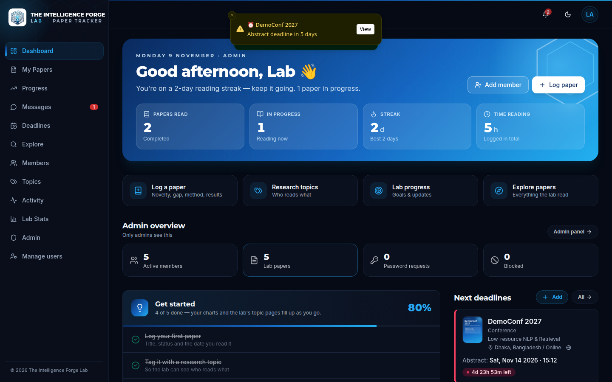
*Screen: বাম দিকে sidebar; উপরে ঘণ্টা, theme switch আর আপনার ছবি। হলুদ pop-up-টা একটা deadline reminder।*

| নাম | কী কাজে লাগে |
|---|---|
| **Dashboard** | আপনার home page: আপনার সংখ্যা, লক্ষ্য, deadline আর lab কী পড়ছে |
| **My Papers** | আপনার log করা সব paper |
| **Progress** | Lab-এর সবাই কোন লক্ষ্যে কাজ করছে, আর তার আপডেট |
| **Messages** | কারো সাথে আলাদা করে বা group-এ chat। লাল সংখ্যা মানে না-পড়া message। |
| **Deadlines** | Conference আর journal-এর deadline, countdown সহ |
| **Explore** | Lab-এর সব paper খোঁজা |
| **Members** | Lab-এর সবাই আর তারা কী পড়ছে |
| **Topics** | Research topic, প্রতিটার paper আর পাঠক সহ |
| **Activity** | পুরো lab-এর সাম্প্রতিক paper আর পরিকল্পনা |
| **Lab Stats** | পুরো lab-এর chart |
| **Admin** / **Manage users** | শুধু admin-দের জন্য। member-রা এগুলো দেখতে পান না। |

**Top bar (উপরে ডান দিকে):**

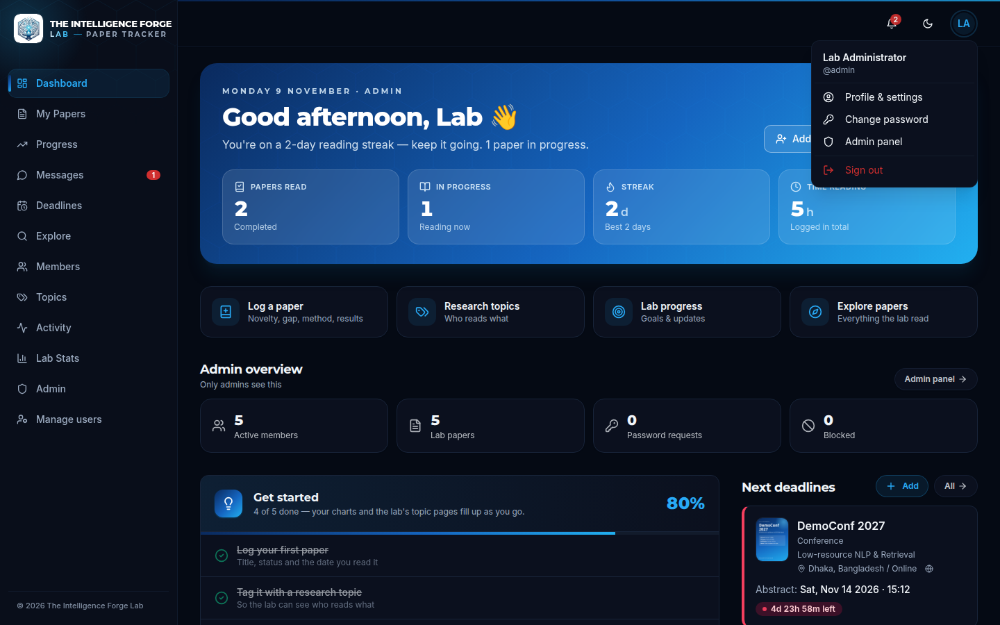
*ছবিতে click করলে Profile & settings, Change password আর Sign out।*

- **🔔 ঘণ্টা:** না-পড়া message আর আগামী ৭ দিনের মধ্যে যেসব deadline আছে। Admin-রা এখানে password
  request-ও দেখেন। লাল সংখ্যা দেখায় কয়টা আছে। ঘণ্টার ভেতরে **Turn on desktop notifications**-ও আছে
  (১১ নম্বর অংশ দেখুন)।
- **☾ / ☀:** dark আর light mode বদলানো।
- **আপনার ছবি বা নামের আদ্যক্ষর:** click করলে **Profile & settings**, **Change password** আর
  **Sign out** দেখাবে।

---

## ২. প্রথমবার login

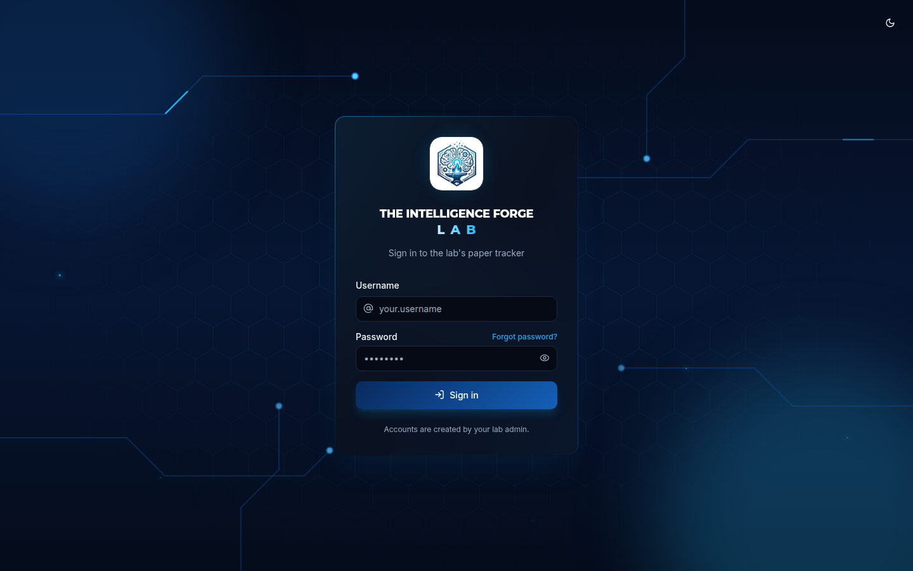
*Login page।*

Admin আপনার account বানিয়ে আপনাকে একটা **username** (যেমন `Rahim.IFL.03`) আর একটা
**temporary password** পাঠাবেন।

1. Browser-এ lab-এর website-এর ঠিকানা খুলুন।
2. **Username** আর **temporary password** লিখে **Sign in**-এ click করুন।
3. এরপর একটা **নতুন password** বেছে নিতে বলবে। Password-এ **কমপক্ষে ৮টা অক্ষর** থাকতে হবে, আর
   **অক্ষর ও সংখ্যা দুটোই** লাগবে। দুইবার লিখে save করুন।

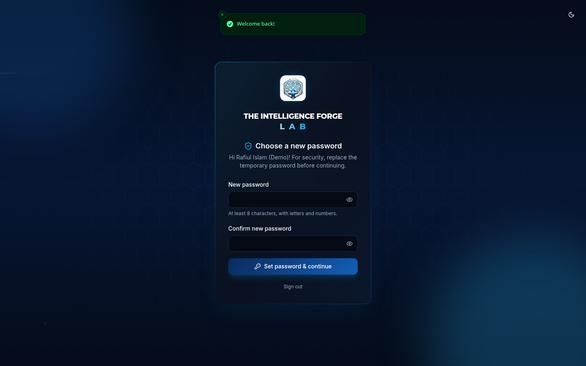
*প্রথম login: নিজের password বেছে নিন।*

4. এরপর **Dashboard** খুলবে।

> **টিপ:** login করবেন username দিয়ে, email দিয়ে নয়।

---

## ৩. Password ভুলে গেলে

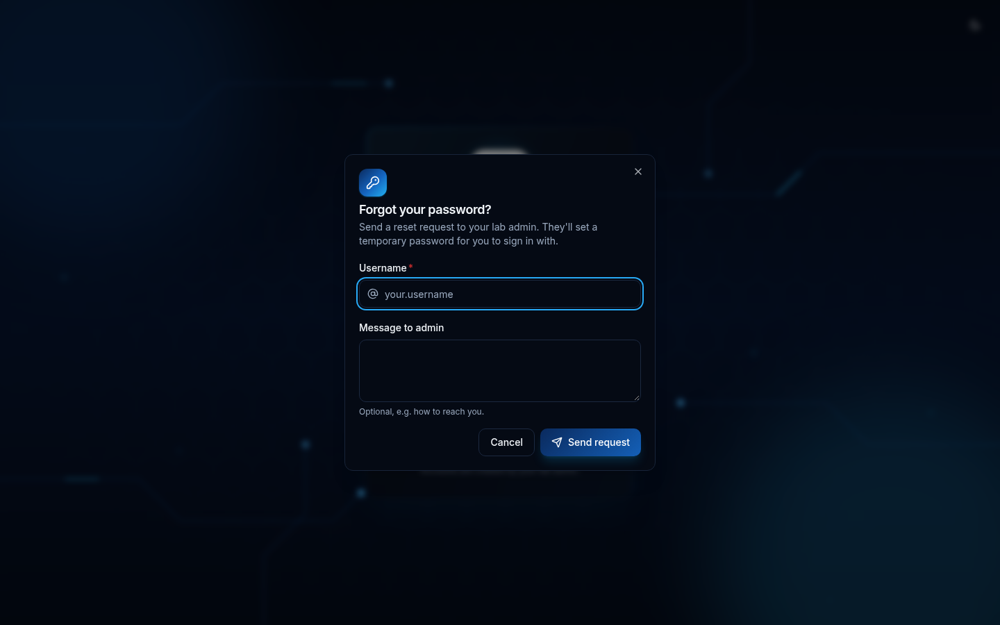
*Forgot password? দিলে admin-এর কাছে request যায়।*

1. Login page-এ Password ঘরের পাশে **Forgot password?**-এ click করুন।
2. আপনার **username** লিখুন। চাইলে ছোট একটা note দিন। তারপর **Send request**-এ click করুন।
3. Admin-এর কাছে বার্তা যাবে। তিনি আপনাকে একটা নতুন temporary password পাঠাবেন।
4. সেটা দিয়ে login করুন, তারপর আবার নিজের password বেছে নিন।

Login করা অবস্থায় password **বদলাতে** চাইলে উপরে ডান দিকে আপনার ছবিতে click করে **Change
password** বেছে নিন। আগের password দিন, তারপর নতুনটা দুইবার লিখুন।

---

## ৪. আপনার profile

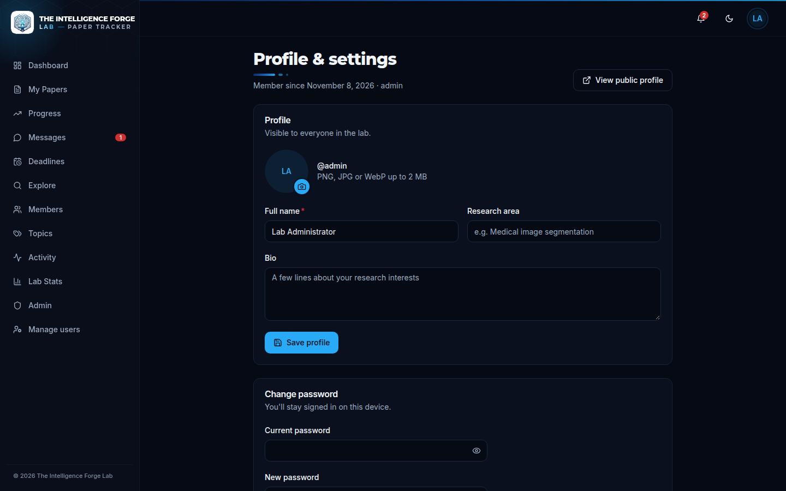
*Profile & settings।*

উপরে ডান দিকে আপনার ছবিতে click করে **Profile & settings** বেছে নিন। এখানে আপনি:

- **profile photo** দিতে পারবেন
- **পুরো নাম** বদলাতে পারবেন
- **research area** লিখতে পারবেন, যেমন "Bangla NLP"
- ছোট একটা **bio** লিখতে পারবেন

**Save** করুন। অন্য member-রা **Members** page-এ আর আপনার paper-এর পাশে এগুলো দেখবেন।

> আপনার **username** শুধু admin বদলাতে পারেন।

---

## ৫. Dashboard

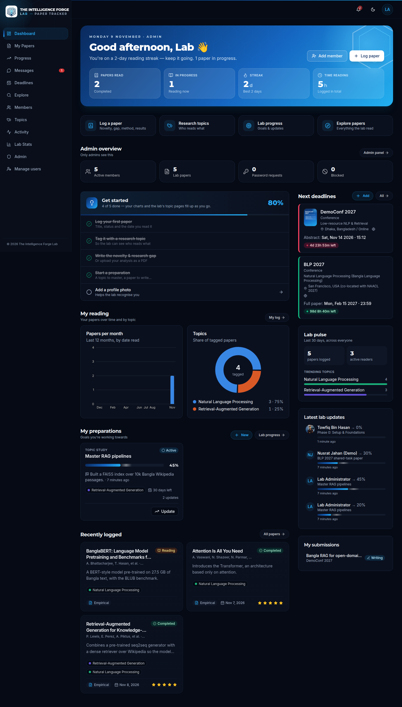
*পুরো Dashboard, উপরের banner থেকে Recently logged পর্যন্ত।*

Dashboard আপনার home page। উপর থেকে নিচে যা যা আছে:

**নীল banner**

- আজকের তারিখ আর শুভেচ্ছা
- এক লাইনে আপনার পড়ার অবস্থা, যেমন আপনার streak, বা গত ৩০ দিনে কয়টা paper পড়েছেন
- চারটা সংখ্যা:

| সংখ্যা | মানে |
|---|---|
| **Papers read** | যেসব paper-এর status **Completed** |
| **In progress** | যেসব paper-এর status **Reading** |
| **Streak** | টানা কত দিন paper পড়েছেন, প্রতিটা paper-এর **Date read** ধরে হিসাব। নিচে আপনার সবচেয়ে বড় streak (Best) দেখায়। |
| **Time reading** | "Time spent" ঘরে লেখা মোট ঘণ্টা |

- **Log paper** button। Admin-রা **Add member** button-ও দেখেন।

**Quick actions:** চারটা shortcut: **Log a paper**, **Research topics**, **Lab progress** আর
**Explore papers**।

**Get started:** নতুন member-দের জন্য একটা checklist। সব ধাপ শেষ হলে এটা নিজে থেকে চলে যায়।

1. প্রথম paper log করা
2. Paper-এ research topic যোগ করা
3. Novelty আর research gap লেখা, বা analysis PDF দেওয়া
4. একটা preparation শুরু করা
5. Profile photo দেওয়া

যেকোনো ধাপে click করলে সরাসরি সেই কাজের page খুলবে।

**My reading:** দুটো chart: মাস অনুযায়ী paper, আর আপনার topic। প্রথম paper log করার পর এগুলো
দেখা যায়।

**My preparations:** আপনার চলমান লক্ষ্য। নতুন যোগ করতে **New**-এ click করুন।

**Recently logged:** আপনার সবচেয়ে নতুন ৪টা paper।

**ডান পাশের কলাম**

- **Next deadlines:** সবচেয়ে কাছের ৩টা conference বা journal deadline, countdown আর poster-এর ছোট
  ছবি সহ। **+ Add** দিয়ে নতুন venue যোগ করা যায় (৯ নম্বর অংশ দেখুন)।
- **Lab pulse:** গত ৩০ দিনে পুরো lab কয়টা paper log করেছে, কতজন পড়ছেন, আর **trending
  topics**। কোনো topic-এ click করলে সেই topic-এর page খুলবে।
- **Latest lab updates:** সবার সাম্প্রতিক progress আপডেট
- **My submissions:** যেসব paper submit করার পরিকল্পনা আছে, status সহ

---

## ৬. Paper log করা

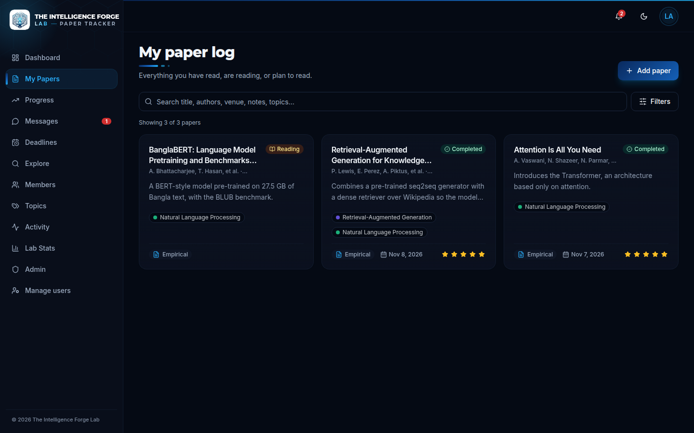
*My Papers: আপনার log করা সব paper, search আর filter সহ।*

Dashboard-এ **Log paper**-এ click করুন, অথবা **My Papers → Add paper**। Form-এ তিনটা অংশ আছে।
শুধু **Title** দেওয়া বাধ্যতামূলক।

### অংশ ১: Bibliographic details (paper-এর পরিচয়)

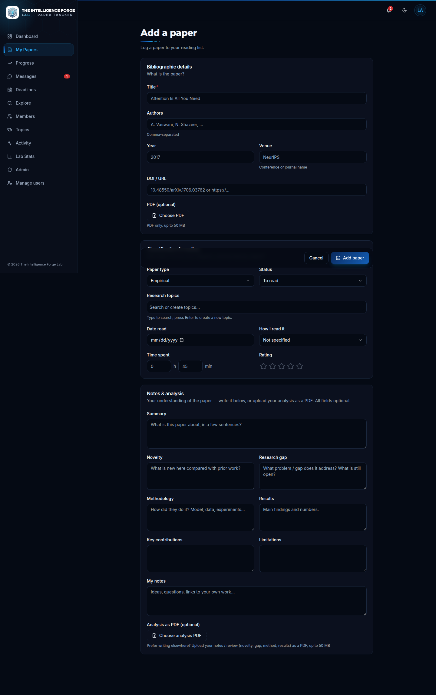
*Add paper form (তিনটা অংশ)।*

- **Title**, **Authors** (কমা দিয়ে আলাদা করে), **Year**, **Venue** (conference বা journal),
  **DOI / URL**
- **PDF (optional):** paper-এর নিজের PDF, **৫০ MB** পর্যন্ত

### অংশ ২: Classification & reading (শ্রেণি আর পড়ার তথ্য)

- **Paper type:** Survey, Empirical, Theoretical, Review, Case study, Dataset বা Other
- **Status:** **To read** (পড়ব), **Reading** (পড়ছি) বা **Completed** (শেষ)
- **Research topics:** লিখতে শুরু করলে topic খুঁজে দেবে। Topic না থাকলে নাম লিখে **Enter** চাপুন,
  নতুন topic তৈরি হয়ে যাবে। একটা paper-এ একাধিক topic দেওয়া যায়।
- **Date read** (কবে পড়েছেন), **How I read it** (কীভাবে পড়েছেন: full read, skim, abstract
  only, group discussion), **Time spent** (ঘণ্টা আর মিনিট), **Rating** (১–৫ তারা)

### অংশ ৩: Notes & analysis (আপনার বিশ্লেষণ)

Paper সম্পর্কে আপনার বোঝাপড়া লিখুন। সব ঘর ঐচ্ছিক।

| ঘর | কী লিখবেন |
|---|---|
| **Summary** | কয়েক বাক্যে paper-টা কী নিয়ে |
| **Novelty** | আগের কাজের তুলনায় নতুন কী আছে |
| **Research gap** | কোন সমস্যা বা ঘাটতি নিয়ে কাজ করেছে, আর কী এখনো বাকি আছে |
| **Methodology** | কীভাবে করেছে: model, data, experiment |
| **Results** | মূল ফলাফল আর সংখ্যা |
| **Key contributions** | মূল অবদান, আপনার নিজের ভাষায় |
| **Limitations** | দুর্বল দিক আর ধরে নেওয়া বিষয় |
| **My notes** | আপনার নিজের ভাবনা আর প্রশ্ন |

**লিখতে না চাইলে:** **Analysis as PDF** অংশে আপনার note বা review একটা PDF হিসেবে upload করুন
(৫০ MB পর্যন্ত)। Lab-এর সবাই paper page আর topic page থেকে এটা খুলতে পারবেন।

Save করতে **Add paper**-এ click করুন।

### Edit আর delete

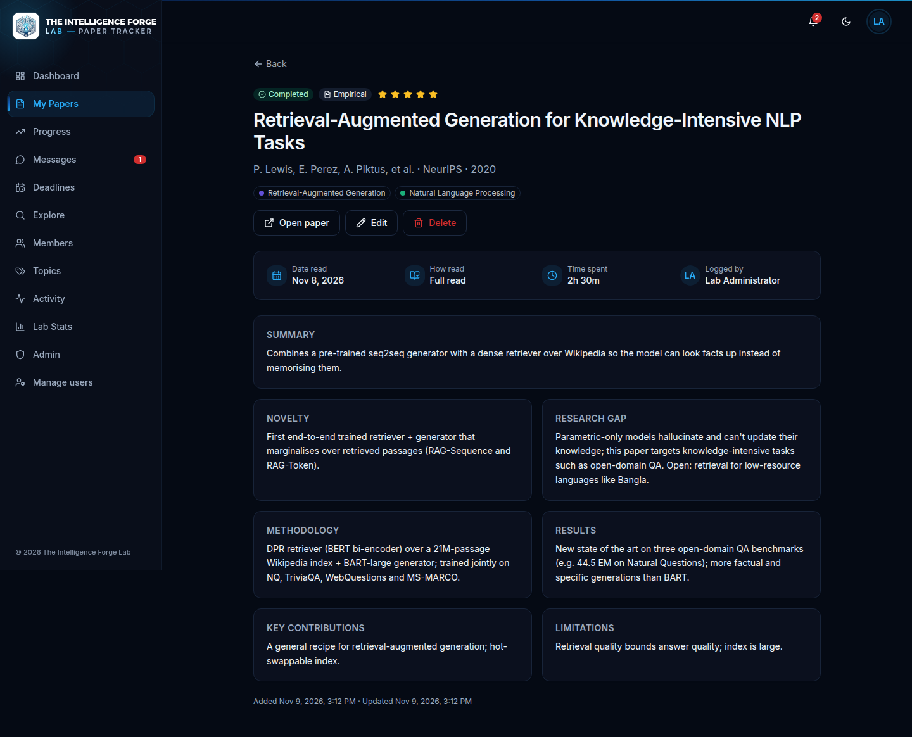
*Novelty, research gap, methodology আর results সহ একটা paper-এর page।*

**My Papers** থেকে paper খুলুন, তারপর **Edit** বা **Delete**-এ click করুন। নিজের paper শুধু
আপনি নিজেই edit করতে পারবেন। Admin-রা যেকোনো paper delete করতে পারেন।

> **টিপ:** **Status = Completed** দিন আর **Date read** পূরণ করুন। তা না হলে paper-টা আপনার
> "Papers read", streak বা chart-এ গোনা হবে না।

---

## ৭. Research topics: কে কী পড়ছে

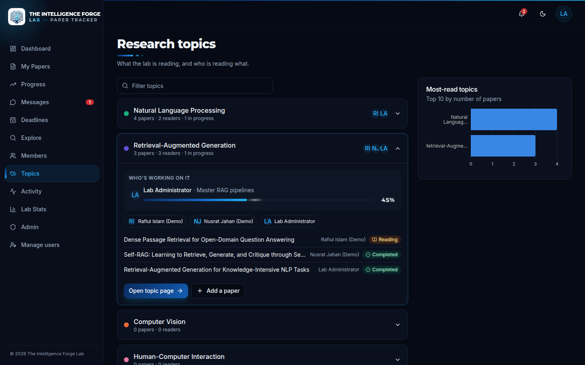
*Topics, একটা topic খোলা অবস্থায়।*

Sidebar-এ **Topics**-এ click করুন। প্রতিটা topic-এর পাশে কয়টা paper আর কতজন পাঠক আছে, তা
দেখায়।

- কোনো topic-এ click করলে সেটা খুলে যাবে। দেখা যাবে কে কে পড়ছেন, সাম্প্রতিক paper, আর
  **Progress**-এ কে এই topic নিয়ে কাজ করছেন।
- পুরোটা দেখতে **Open topic page**-এ click করুন।

### Topic page

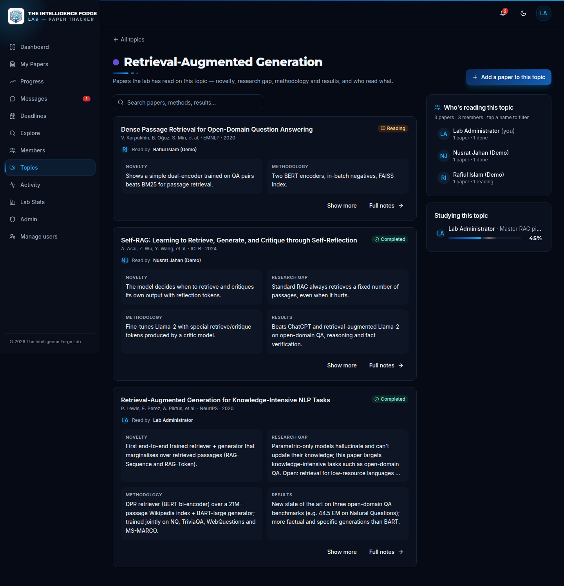
*Topic page: প্রতিটা paper তার বিশ্লেষণ সহ, আর কে কে পড়ছেন।*

**বাম দিকে: এই topic-এর সব paper।** প্রতিটা কার্ডে আছে:

- title, author আর venue, সাথে status
- **কে পড়েছেন**
- তার লেখা **Novelty**, **Research gap**, **Methodology** আর **Results**। পুরো লেখা পড়তে **Show
  more**-এ click করুন।
- পাঠক PDF দিয়ে থাকলে **Analysis PDF** button
- **Full notes**, যেটায় click করলে paper-এর পুরো page খোলে

Search box দিয়ে title, method আর result-এর ভেতরে খোঁজা যায়।

**ডান দিকে: "Who's reading this topic"।** এই topic-এ যাদের paper আছে, তাদের সবার তালিকা, কয়টা
পড়ছেন আর কয়টা শেষ সহ। **কারো নামে click করলে** শুধু তার paper দেখাবে। আবার সবারটা দেখতে **Show
everyone**-এ click করুন।

উপরে ডান দিকে **Add a paper to this topic**-এ click করলে paper form খুলবে, আর এই topic আগে থেকেই
select করা থাকবে।

---

## ৮. Progress: আপনার লক্ষ্য সবাইকে জানানো

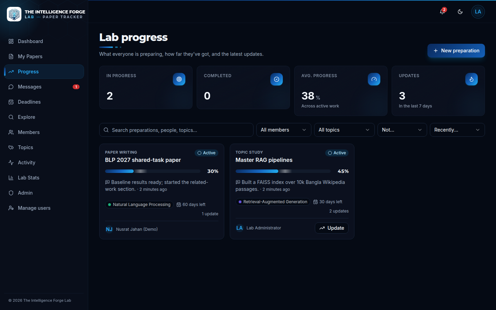
*Progress board।*

**Preparation** মানে এমন কিছু যার দিকে আপনি কাজ করছেন, যেমন কোনো topic শেখা, paper লেখা,
experiment চালানো বা পরীক্ষার প্রস্তুতি। পুরো lab এটা দেখতে পায়।

1. **Progress** খুলে **New preparation**-এ click করুন, অথবা Dashboard-এ **New** ব্যবহার করুন।
2. **Title** আর **Category** দিন। চাইলে **research topic**, **target date** (শেষ করার তারিখ), শুরুর
   শতাংশ আর বিবরণও দিতে পারেন।
3. কাজ এগোলে preparation খুলে **Post update**-এ click করুন। Slider বা 10/25/50/75/100% button দিয়ে
   নতুন শতাংশ ঠিক করুন, আর কী করেছেন লিখুন।
4. **100%** হলে এটা নিজে থেকে **Completed** হয়ে যায়।

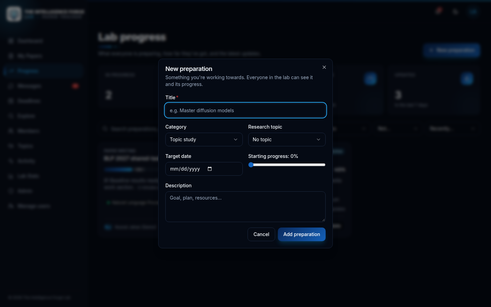
*New preparation।*

আপনার আপডেট দেখা যাবে **Progress** board-এ, আপনার profile-এ, topic-এর page-এ, **Activity**-তে,
আর সবার Dashboard-এর **Latest lab updates**-এ।

---

## ৯. Deadlines, submissions আর poster

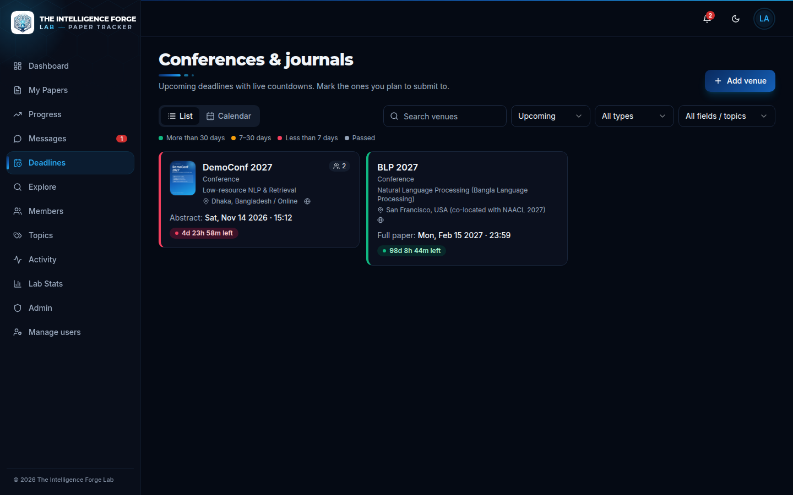
*চলমান countdown আর poster সহ Deadlines।*

**Deadlines** খুলুন। সবচেয়ে কাছের deadline অনুযায়ী venue সাজানো থাকে, চলমান countdown সহ:

- 🟢 ৩০ দিনের বেশি বাকি
- 🟡 ৭–৩০ দিন বাকি
- 🔴 ৭ দিনের কম বাকি
- ⚪ শেষ হয়ে গেছে

এখানে আপনি:

- **List** আর **Calendar** view বদলাতে পারবেন
- upcoming বা past, conference বা journal, আর field দিয়ে filter করতে পারবেন
- কোনো venue খুলে তার সব তারিখ দেখতে পারবেন: abstract, full paper, notification আর camera-ready

**Submit করার পরিকল্পনা আছে?** Venue খুলে **I'm planning to submit**-এ click করুন। আপনার paper-এর
title আর status (Planning, Writing, Submitted, Accepted বা Rejected) দিন, আর কাজ এগোলে আপডেট করুন।
এটা আপনার Dashboard-এর **My submissions**-এ দেখাবে।

### Conference বা journal যোগ করা (poster সহ)

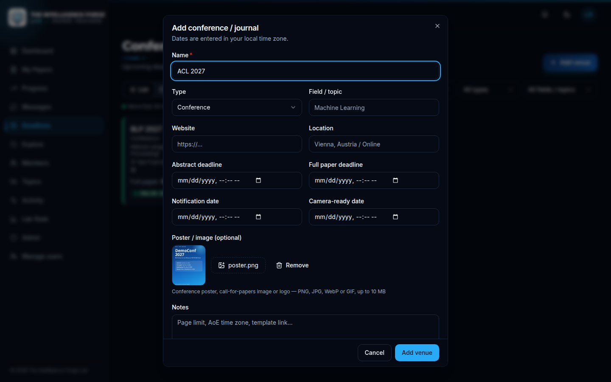
*Add conference / journal, একটা poster বেছে নেওয়া অবস্থায়।*

1. Deadlines page-এ **Add venue**-এ click করুন, অথবা Dashboard-এ *Next deadlines*-এর পাশে **+ Add**।
2. **Name** (যেমন "BLP 2027"), **Type**, **Field / topic**, **Website** আর **Location** দিন।
3. যে তারিখগুলো জানেন সেগুলো দিন: **Abstract deadline**, **Full paper deadline**, **Notification
   date** আর **Camera-ready date**। তারিখ আপনার নিজের time zone-এ লিখবেন।
4. **Poster / image (optional):** **Choose image**-এ click করে conference-এর poster, call-for-papers-এর
   ছবি বা logo বেছে নিন (PNG, JPG, WebP বা GIF, **১০ MB** পর্যন্ত)। নিচে preview দেখাবে।
5. দরকার হলে **Notes** লিখুন (page limit, template link, AoE সময়…), তারপর **Add venue**-এ click করুন।

Poster-টা deadline card-এ ছোট ছবি হিসেবে, আর venue page-এর উপরে বড় করে দেখাবে। সেখানে click করলে পুরো

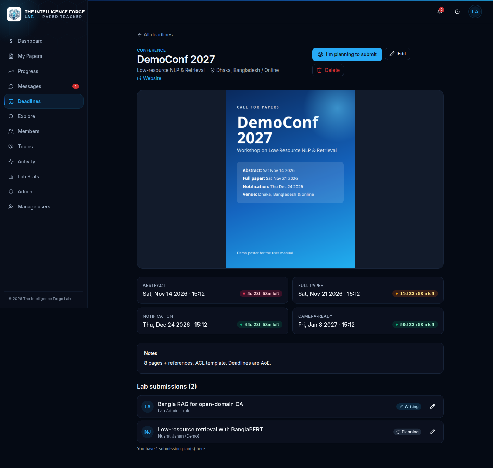
*Venue page: poster, সব তারিখ আর কে কে submit করবেন।*

আকারে খুলবে। বদলাতে বা মুছতে venue খুলে **Edit**-এ click করুন।

Admin **"Members can add conferences & journals"** চালু রাখলে member-রা venue যোগ করতে পারেন। এটা আগে
থেকেই চালু থাকে। আপনি শুধু নিজের যোগ করা venue edit বা delete করতে পারবেন। Admin-রা যেকোনো venue edit
বা delete করতে পারেন।

---

## ১০. Messages: lab-এর সাথে chat

**Messages** অনেকটা WhatsApp-এর মতো, তবে lab tracker-এর ভেতরে। Sidebar থেকে খুলুন।

### Screen

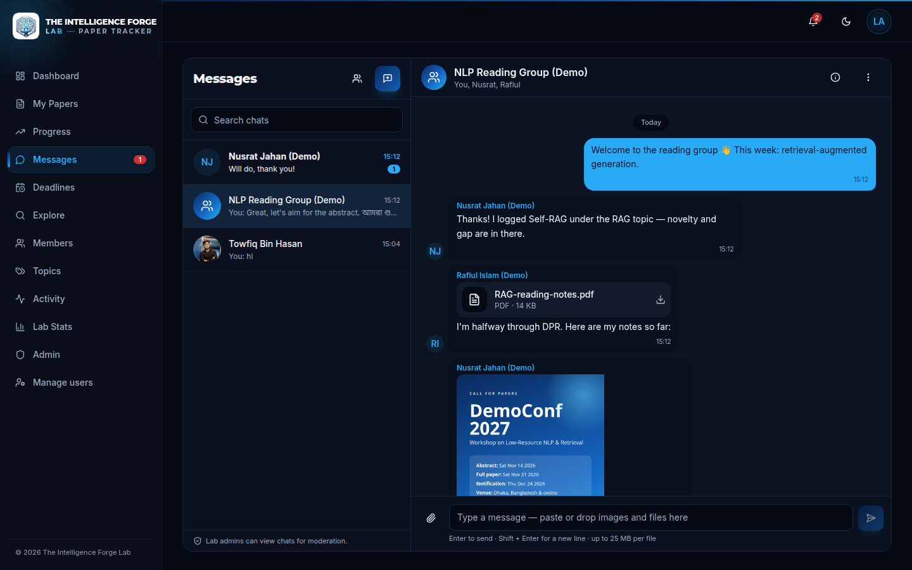
*Messages: বাম দিকে chat-এর তালিকা, ডান দিকে খোলা group chat (PDF আর ছবি সহ)।*

- **বাম দিকে:** আপনার সব chat, সবচেয়ে নতুনটা উপরে। প্রতিটা সারিতে শেষ message আর তার সময় দেখায়। মোটা
  লেখা আর নীল সংখ্যা মানে না-পড়া message আছে। 🔒 মানে admin ওই chat block করেছেন।
- **ডান দিকে:** খোলা chat। আপনার message ডান দিকে নীল রঙে, অন্যদের message বাম দিকে।

### Chat শুরু করা

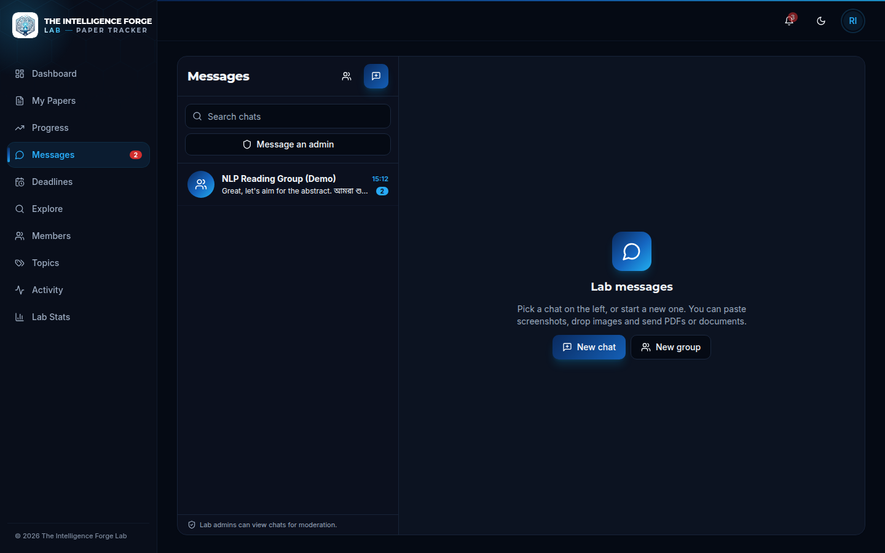
*Member-এর চোখে: New chat, New group আর Message an admin।*

- **একজনের সাথে:** নীল **✚ (New chat)** button-এ click করে একজনকে বেছে নিন। Admin-দের নাম সবার উপরে
  থাকে। **Members** থেকে কারো profile খুলে **Message**-এ click করলেও হবে।
- **Admin-কে message:** search box-এর নিচে **Message an admin**-এ click করুন।
- **Group:** **👥 (New group)** button-এ click করুন। **Group name** লিখুন, member-দের পাশে টিক দিন, তারপর
  **Create group**। আপনি group-এর **owner** হবেন।

### Message, ছবি আর file পাঠানো

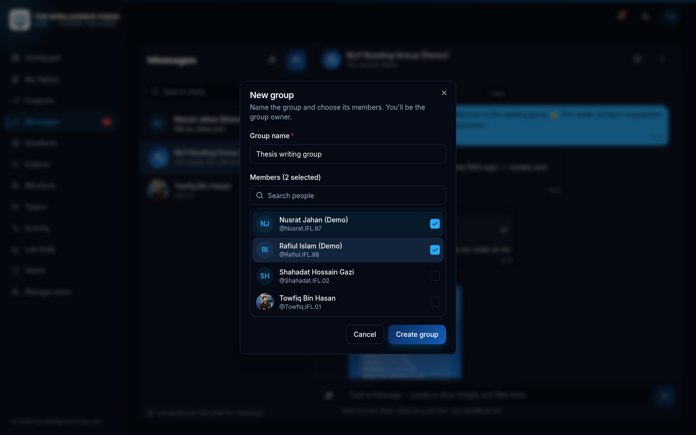
*New group: নাম দিন, member-দের পাশে টিক দিন।*

- নিচের ঘরে লিখে **Enter** চাপলে message চলে যাবে। **Shift + Enter** চাপলে নতুন লাইন হবে। বাংলায়
  স্বাভাবিকভাবেই লেখা যায়।
- **Screenshot বা ছবি paste করা:** ছবিটা copy করুন (যেমন Print Screen key দিয়ে, বা "Copy image"), message
  ঘরে click করে **Ctrl + V** চাপুন।
- **Drag and drop:** computer থেকে file টেনে এনে chat-এর উপর ছেড়ে দিন।
- **📎 Attach:** computer থেকে file বেছে নিন।

পাঠানো যায়: **ছবি** (PNG, JPG, WebP, GIF), **PDF**, **Word, Excel আর PowerPoint** file, **text/CSV** আর
**ZIP**। প্রতিটা file **২৫ MB** পর্যন্ত, একবারে ১০টা পর্যন্ত। পাঠানোর আগে file-গুলো ঘরের উপরে দেখায়।
কোনোটা বাদ দিতে **×**-এ click করুন। যা লিখবেন, সেটা প্রথম file-এর সাথে যাবে।

ছবি chat-এর ভেতরেই দেখা যায়, click করলে পুরো আকারে খোলে। PDF আর document একটা file card হিসেবে দেখায়,
click করলে খোলে বা download হয়।

### Message-এর অপশন

কোনো message-এর উপর mouse নিয়ে **⋮**-এ click করুন:

- **Copy text:** লেখা copy করা
- **Open / download:** file খোলা বা download করা
- **Delete:** **নিজের** message সবার কাছ থেকে মুছে দেয়। Admin-রা যেকোনো message মুছতে পারেন।

### Group info

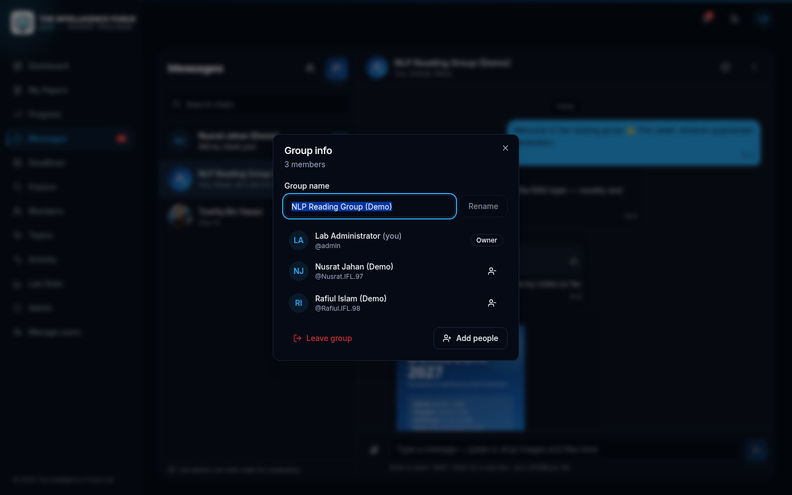
*Group info: member, নাম বদলানো, যোগ বা বাদ দেওয়া, বেরিয়ে যাওয়া।*

Group-এ উপরে ডান দিকে **ⓘ**-এ click করলে member-দের তালিকা দেখাবে। **Owner** (আর admin) group-এর **নাম
বদলাতে**, **Add people** দিয়ে মানুষ যোগ করতে আর কাউকে বাদ দিতে পারেন। যে কেউ **Leave group** দিয়ে
বেরিয়ে যেতে পারেন। Owner বেরিয়ে গেলে সবচেয়ে পুরনো member নতুন owner হন।

> **গোপনীয়তা:** chat শুধু তার member-রা **আর lab-এর admin-রা** দেখতে পান। নিয়ম মানা হচ্ছে কিনা দেখার
> জন্য admin chat পড়তে পারেন। Chat-এ password বা গোপন তথ্য পাঠাবেন না।

---

## ১১. Notification আর reminder

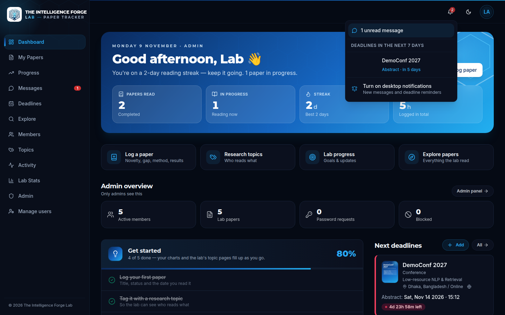
*ঘণ্টা: না-পড়া message, deadline আর Turn on desktop notifications।*

**App-এর ভেতরে**

- **🔔 ঘণ্টা** না-পড়া message আর আগামী ৭ দিনের deadline গোনে। Click করলে তালিকা দেখাবে, যেকোনোটায়
  click করলে সেটা খুলবে।
- Sidebar-এ **Messages**-এর পাশে না-পড়া message-এর সংখ্যা দেখায়।
- অন্য page-এ থাকা অবস্থায় message এলে screen-এর নিচে ছোট একটা pop-up আসে, তাতে **Open** button থাকে।

**Deadline reminder।** Abstract আর full-paper deadline-এর **৭ দিন, ৩ দিন, ১ দিন আগে আর ঠিক সেই দিন**
app আপনাকে মনে করিয়ে দেয়। প্রতিটা reminder একবারই আসে, app খুললে pop-up হিসেবে।

**Desktop notification।** Tab পেছনে থাকলেও notification পেতে পারেন:

1. **🔔 ঘণ্টা**-য় click করে **Turn on desktop notifications** বেছে নিন।
2. Browser অনুমতি চাইলে **Allow**-এ click করুন।

এরপর থেকে নতুন message আর deadline reminder আপনার computer-এর notification হিসেবে আসবে।

> Desktop notification তখনই আসে যখন Paper Tracker browser-এর কোনো tab-এ খোলা থাকে। Tab পেছনে বা
> minimise করা থাকলেও চলবে, তবে বন্ধ করা যাবে না। ভুল করে **Block** চেপে থাকলে address bar-এর বাম দিকে
> 🔒 চিহ্নে click করুন, **Notifications** বদলে **Allow** করুন, তারপর page reload করুন।

---

## ১২. পুরো lab ঘুরে দেখা

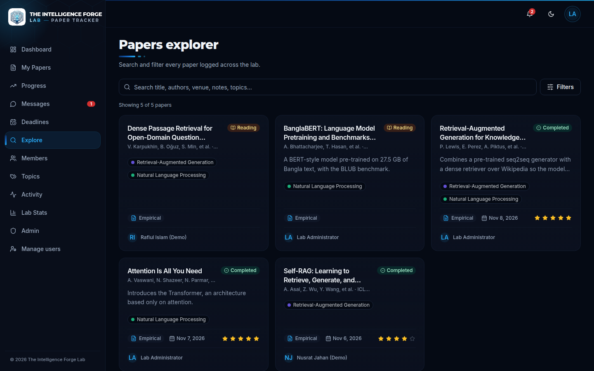
*Explore: lab-এর সব paper।*

| Page | কীভাবে ব্যবহার করবেন |
|---|---|
| **Explore** | Lab-এর সব paper খুঁজুন। **topic, type, status, year বা member** দিয়ে filter করুন, আর সাজানোর ক্রম বদলান। Paper-এ click করলে তার note পড়া যাবে। |
| **Members** | Lab-এর সবাই। কারো নামে click করলে তার profile, সংখ্যা, chart আর paper দেখা যাবে। অন্যের paper আপনি শুধু পড়তে পারবেন, বদলাতে পারবেন না। |
| **Activity** | নতুন paper, submission আর progress আপডেটের timeline |
| **Lab Stats** | পুরো lab-এর chart: মাস অনুযায়ী paper, topic, paper type আর top readers |

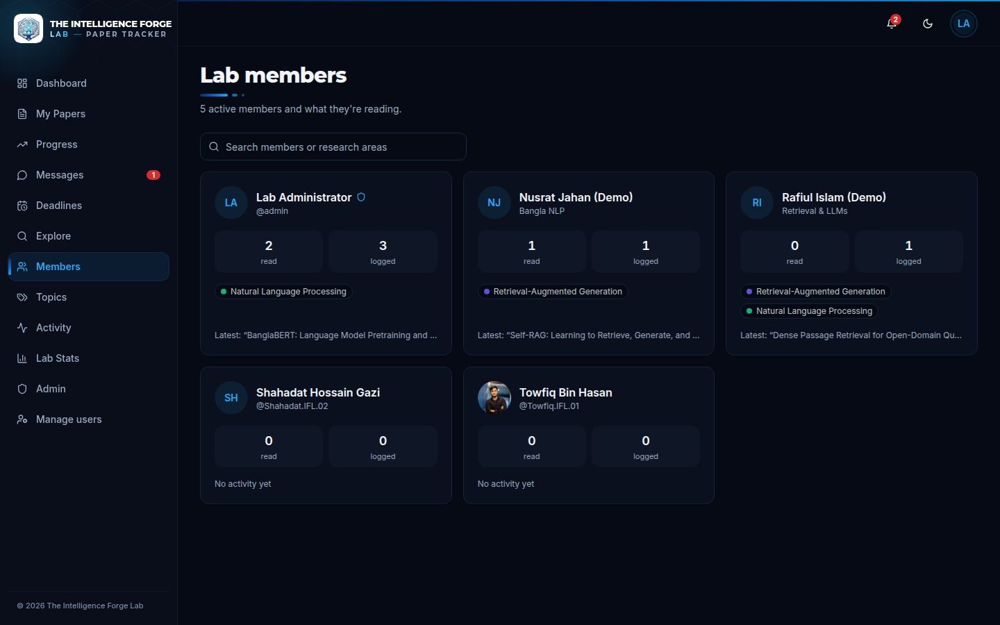
*Members।*

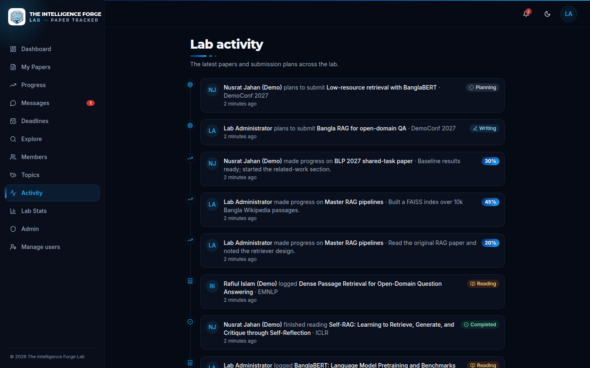
*Activity।*

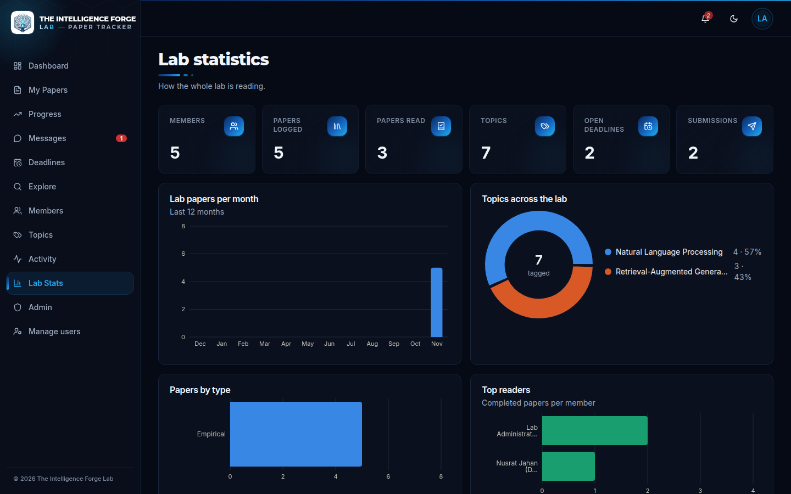
*Lab Stats।*

---

## ১৩. Admin-দের জন্য

এই অংশের কাজগুলো শুধু **Admin** role-এর account করতে পারে। Member-রা **Admin** বা **Manage
users** link দেখতে পান না, ওই page খুলতে পারেন না, আর server-ও তাদের request বাতিল করে দেয়।

### ১৩.১ Dashboard-এর Admin overview

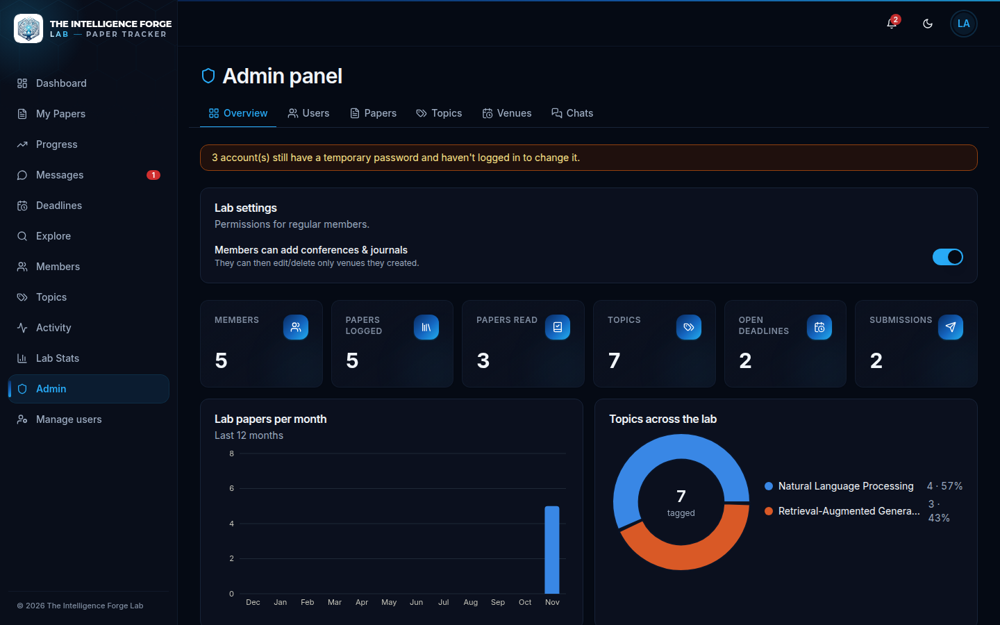
*Admin → Overview।*

Admin-রা Dashboard-এ একটা বাড়তি সারি দেখেন। যেকোনো কার্ডে click করলে admin page-এ চলে যাবে।

| কার্ড | মানে |
|---|---|
| **Active members** | যারা login করতে পারেন |
| **Lab papers** | Lab-এ log করা মোট paper |
| **Password requests** | কেউ password reset-এর অপেক্ষায় থাকলে হলুদ হয়ে যায় |
| **Blocked** | Block করা account |

### ১৩.২ Users পরিচালনা (Manage users)

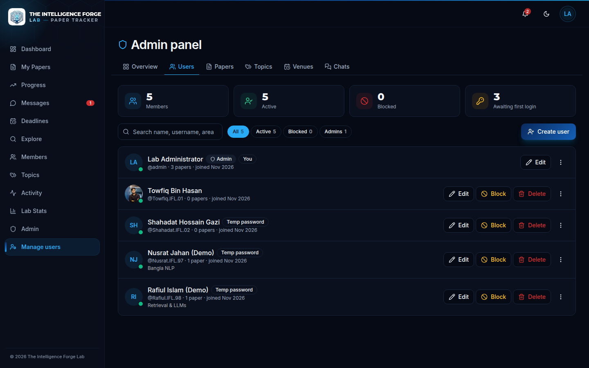
*Manage users: সারাংশ, filter, আর প্রতিটা সারিতে Edit / Block / Delete।*

Sidebar-এ **Manage users**-এ click করুন, অথবা **Admin → Users**।

**উপরে:** **Members** (মোট), **Active**, **Blocked** আর **Awaiting first login** (যারা এখনো
temporary password বদলাননি) এর সংখ্যা।

**খোঁজা আর filter:** নাম, username বা research area দিয়ে খুঁজুন। **All / Active / Blocked /
Admins** button দিয়ে filter করুন।

**প্রতিটা user-এর সারিতে** ছবির কোণে একটা বিন্দু থাকে: 🟢 মানে active, 🔴 মানে blocked। সাথে এই
button-গুলো থাকে:

| Button | কী করে |
|---|---|
| ✏️ **Edit** | **পুরো নাম**, **username**, **research area** আর **bio** বদলানো |
| 🚫 **Block** | আগে নিশ্চিত হতে জিজ্ঞেস করে, তারপর ওই ব্যক্তিকে sign out করে দেয় আর login বন্ধ করে দেয়। তার paper থেকে যায়। সারিতে **Blocked** লেখা দেখায়। |
| ✅ **Unblock** | Block করা user-এর ক্ষেত্রে Block-এর জায়গায় দেখায়। আবার login চালু করে। |
| 🗑️ **Delete** | Account, তার সব paper, PDF আর submission **চিরতরে** মুছে দেয়। **এটা আর ফেরানো যায় না।** |
| ⋮ **More** | **Reset password**, **Make admin** / **Make member** |

**সুরক্ষার নিয়ম:**

- নিজের account block বা delete করা যায় না।
- **শেষ** admin-কে block, delete বা member বানানো যায় না।
- পরে কখনো ওই ব্যক্তির data লাগতে পারে মনে হলে Delete না করে **Block** করুন।

> **Username বদলালে:** ওই ব্যক্তি এরপর থেকে **নতুন** username দিয়ে login করবেন, password একই
> থাকবে। তাকে জানিয়ে দিন।

### ১৩.৩ নতুন user তৈরি করা

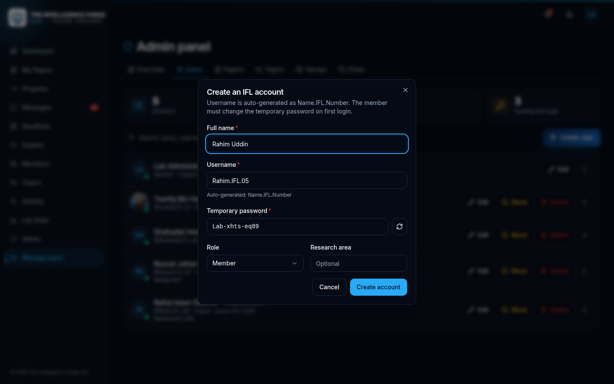
*Create user।*

1. **Manage users → Create user**।
2. **পুরো নাম** লিখুন। `Rahim.IFL.04`-এর মতো একটা username নিজে থেকে প্রস্তাব করবে, চাইলে বদলাতে
   পারবেন।
3. তৈরি হয়ে আসা **temporary password** রাখুন, অথবা নিজে একটা লিখুন। এতে ৮+ অক্ষর থাকতে হবে, অক্ষর
   আর সংখ্যা দুটোই লাগবে।
4. **Member** বা **Admin** বেছে নিন। চাইলে research area দিন।
5. **Create account**-এ click করুন। Username আর password **একবারই** দেখাবে। **Copy** করে
   ব্যক্তিগতভাবে তাকে পাঠিয়ে দিন।

### ১৩.৪ Password request

কেউ **Forgot password?** ব্যবহার করলে request-টা **🔔 ঘণ্টা**-য় আর **Manage users**-এর একদম
উপরে দেখায়।

- **Reset password**-এ click করুন। একটা নতুন temporary password একবার দেখাবে। সেটা ব্যক্তিগতভাবে
  পাঠিয়ে দিন। Request নিজে থেকে বন্ধ হয়ে যাবে।
- কিছু না করে request বন্ধ করতে চাইলে **Dismiss**-এ click করুন।

যেকোনো সময় **⋮ → Reset password** দিয়েও যে কারো password reset করা যায়।

### ১৩.৫ Admin-এর অন্য page

Sidebar-এ **Admin** খুলুন। উপরের tab-গুলো হলো:

| Tab | কাজ |
|---|---|
| **Overview** | Lab-এর পরিসংখ্যান, আর **"Members can add conferences & journals"** চালু বা বন্ধ করার switch |
| **Users** | **Manage users**-এর মতোই |
| **Papers** | সব paper খুঁজে duplicate বা ভুল entry delete করা |
| **Topics** | Topic তৈরি, নাম বদলানো, রং বদলানো বা delete করা। Topic delete করলে শুধু tag মুছে যায়, paper থেকে যায়। |
| **Venues** | Conference আর journal যোগ, edit বা delete করা |
| **Chats** | Lab-এর সব chat পড়া, block করা আর delete করা (১৩.৬ দেখুন) |

### ১৩.৬ Chat পরিচালনা

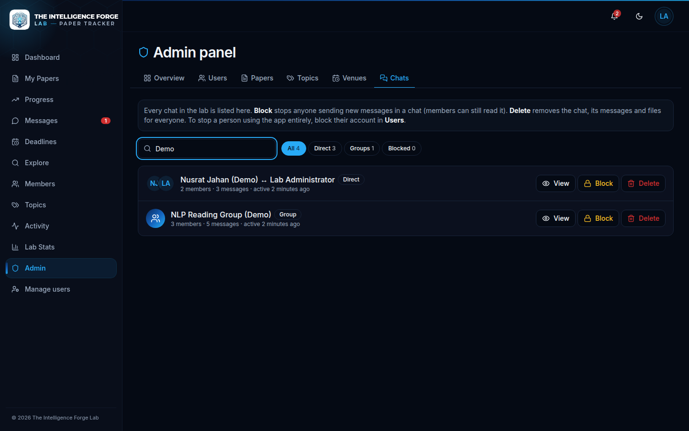
*Admin → Chats: প্রতিটা chat-এ View, Block আর Delete।*

**Admin → Chats** খুলুন। Lab-এর সব direct chat আর group এখানে দেখায়, সাথে member, message-এর সংখ্যা আর
শেষ কবে কথা হয়েছে। Search box আর **All / Direct / Groups / Blocked** filter দিয়ে খুঁজুন।

| Button | কী করে |
|---|---|
| 👁 **View** | Chat খুলে পড়া যায়। কোনো message-এর উপর mouse নিয়ে **⋮ → Delete** দিয়ে সেটা মুছতে পারবেন। |
| 🔒 **Block** | ওই chat-এ কেউ আর নতুন message পাঠাতে পারবে না। Member-রা পড়তে পারবেন, আর দেখবেন যে এটা block করা। |
| 🔓 **Unblock** | আবার message পাঠানো চালু হয় |
| 🗑️ **Delete** | Chat, তার সব message আর file সবার জন্য **চিরতরে** মুছে দেয় |

যে chat-এ আপনি নিজেও আছেন, সেখানে উপরে ডান দিকের **⋮** menu থেকেও একই কাজ করা যায়।

> **Chat block বনাম মানুষ block:** chat block করলে শুধু ওই chat-এ message বন্ধ হয়। কাউকে পুরো app থেকে
> বন্ধ করতে **Manage users** (১৩.২)-এ তার account block করুন। Block করা account থেকে কোথাও message
> পাঠানো যায় না।

---

## ১৪. সাধারণ প্রশ্ন

**আমার chart-এ "No data yet" দেখাচ্ছে।**
আপনি এখনো কোনো paper log করেননি। একটা paper log করুন, **Status = Completed** দিন আর **Date
read** পূরণ করুন।

**আমার streak 0 দেখাচ্ছে।**
Streak গোনে টানা কত দিন কোনো paper-এর **Date read** আছে। আজ বা গতকাল থেকে হিসাব শুরু হয়। মাঝে
কোনো দিন paper না থাকলে streak আবার শূন্য থেকে শুরু হয়।

**অন্যের paper edit করতে পারছি না।**
এটাই নিয়ম। যিনি paper log করেছেন, শুধু তিনিই edit করতে পারেন।

**যে topic দরকার সেটা নেই।**
Paper form-এ **Research topics** ঘরে topic-এর নাম লিখে **Enter** চাপুন।

**PDF upload হচ্ছে না।**
শুধু **৫০ MB** পর্যন্ত PDF file নেওয়া হয়।

**Sign out হয়ে গেছি, আর login করতে পারছি না।**
আপনার account block করা হতে পারে, অথবা password reset করা হয়েছে। Lab admin-এর সাথে যোগাযোগ করুন।

**Sidebar-এ Messages দেখা যাচ্ছে না।**
Chat এখনো চালু করা হয়নি। Admin-কে সবশেষ database update চালাতে বলুন।

**কোনো chat-এ message পাঠাতে পারছি না।**
Admin ওই chat block করেছেন (🔒 **Blocked** দেখাবে), অথবা আপনি আর ওই group-এ নেই।

**File পাঠানো যাচ্ছে না।**
File ২৫ MB-এর কম হতে হবে, আর হতে হবে ছবি, PDF, Office document, text/CSV বা ZIP।

**Desktop notification আসছে না।**
🔔 ঘণ্টা থেকে চালু করুন, আর Paper Tracker একটা tab-এ খোলা রাখুন। Browser আর computer-এর "Do not
disturb" mode notification আটকাচ্ছে কিনা দেখুন।

**আমার paper আর note কারা দেখতে পায়?**
Lab-এর যারা login করা আছেন, তারা সবাই। Internet-এ কিছুই public নয়।

---

*উত্তর খুঁজে না পেলে lab admin-কে জিজ্ঞেস করুন।*
