# User Manual: Desktop

**The Intelligence Forge Lab: Paper Tracker**

🌐 **Language:** English · [বাংলা](USER_MANUAL.bn.md)

This manual explains how to use the Paper Tracker on a **computer** (laptop or desktop) in a
web browser such as Chrome, Edge or Firefox. Members should read sections 1–12. Admins should
also read section 13.

---

## Contents

1. [The screen at a glance](#1-the-screen-at-a-glance)
2. [Signing in for the first time](#2-signing-in-for-the-first-time)
3. [Forgot your password](#3-forgot-your-password)
4. [Your profile](#4-your-profile)
5. [The dashboard](#5-the-dashboard)
6. [Logging a paper](#6-logging-a-paper)
7. [Research topics: who reads what](#7-research-topics-who-reads-what)
8. [Progress: sharing your goals](#8-progress-sharing-your-goals)
9. [Deadlines, submissions and posters](#9-deadlines-submissions-and-posters)
10. [Messages: chat with the lab](#10-messages-chat-with-the-lab)
11. [Notifications and reminders](#11-notifications-and-reminders)
12. [Exploring the lab](#12-exploring-the-lab)
13. [For admins](#13-for-admins)
14. [Common questions](#14-common-questions)

---

## 1. The screen at a glance

The screen has two fixed parts: a **sidebar** on the left and a **top bar**.

**Sidebar:** click any item to open that page.

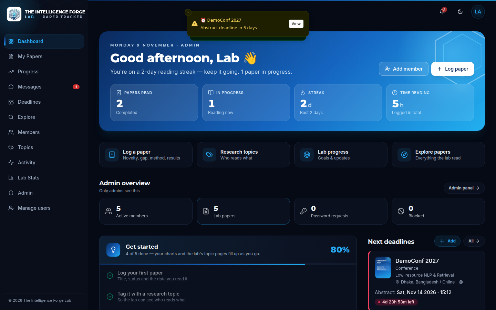
*The screen: sidebar on the left; top bar with the bell, theme switch and your photo. The yellow pop-up is a deadline reminder.*

| Item | What it is for |
|---|---|
| **Dashboard** | Your home page: your numbers, goals, deadlines and what the lab is reading |
| **My Papers** | Every paper you have logged |
| **Progress** | Goals people in the lab are working towards, with progress updates |
| **Messages** | Chat with members one-to-one or in groups. A red number shows unread messages. |
| **Deadlines** | Conference and journal deadlines, with countdowns |
| **Explore** | Search all papers in the lab |
| **Members** | Everyone in the lab and what they read |
| **Topics** | Research topics, each with its papers and readers |
| **Activity** | The latest papers and plans across the lab |
| **Lab Stats** | Charts for the whole lab |
| **Admin** / **Manage users** | Admins only. Hidden for members. |

**Top bar (top right):**

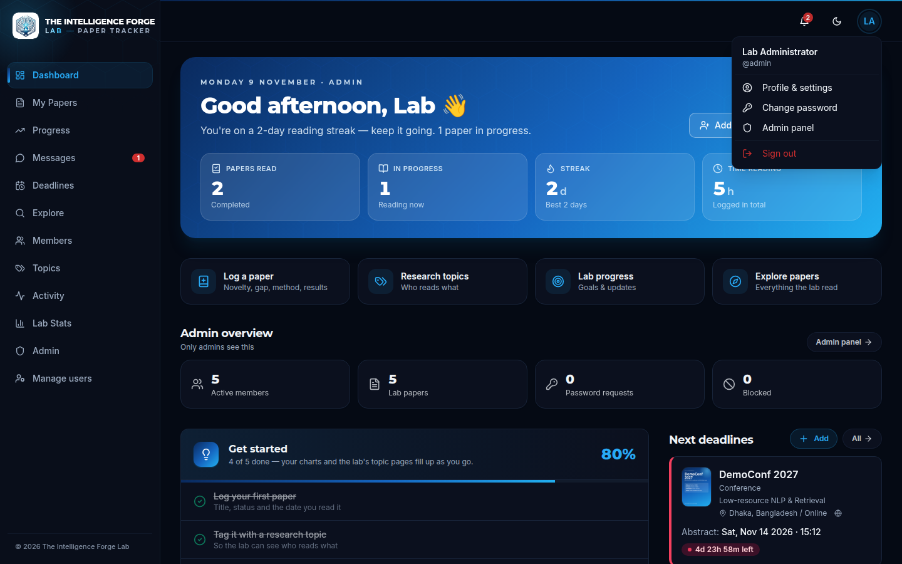
*Click your photo for Profile & settings, Change password and Sign out.*

- **🔔 Bell:** unread messages and deadlines due in the next 7 days. Admins also see password
  requests here. A red number shows how many items there are. The bell also has **Turn on
  desktop notifications** (see section 11).
- **☾ / ☀:** switches between dark and light mode.
- **Your photo or initials:** opens a menu with **Profile & settings**, **Change password** and
  **Sign out**.

---

## 2. Signing in for the first time

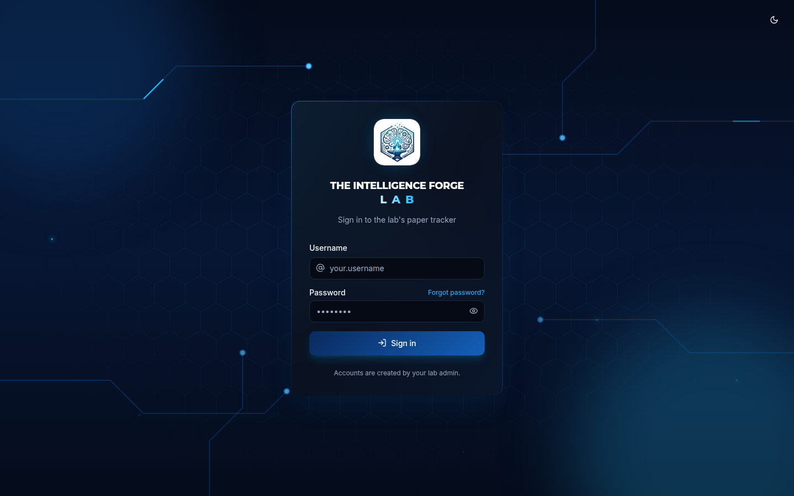
*The sign-in page.*

Your admin creates your account and sends you a **username** (for example `Rahim.IFL.03`) and a
**temporary password**.

1. Open the lab's website address in your browser.
2. Type your **username** and **temporary password**, then click **Sign in**.
3. You are asked to choose a **new password**. It needs **at least 8 characters**, with both
   **letters and numbers**. Type it twice and save.

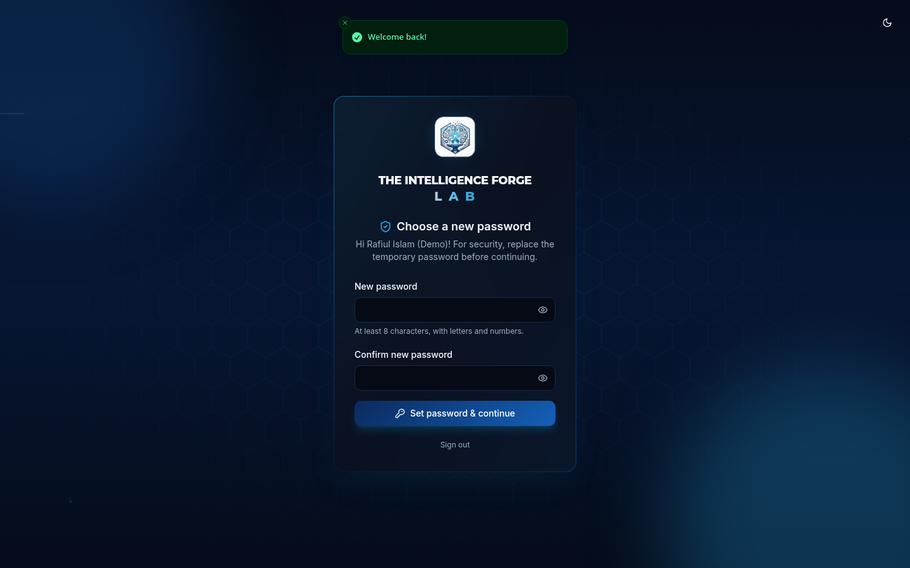
*First sign-in: choose your own password.*

4. You land on the **Dashboard**.

> **Tip:** sign in with your username, not an email address.

---

## 3. Forgot your password

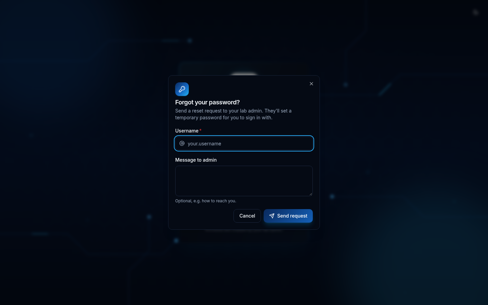
*Forgot password? sends a request to your admin.*

1. On the sign-in page, click **Forgot password?**, next to the Password field.
2. Enter your **username** and, if you like, a short note. Then click **Send request**.
3. Your admin is notified. They will send you a new temporary password.
4. Sign in with it, then choose your own password again.

To **change** your password while signed in, click your photo (top right) and choose **Change
password**. Enter your current password, then the new one twice.

---

## 4. Your profile

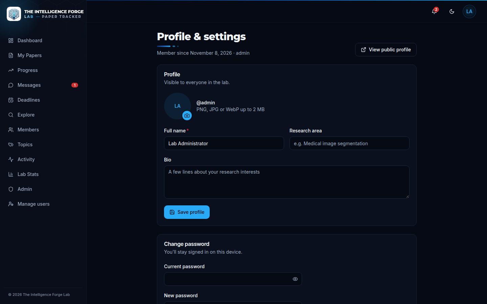
*Profile & settings.*

Click your photo (top right) and choose **Profile & settings**. You can:

- upload a **profile photo**
- change your **full name**
- set your **research area**, for example "Bangla NLP"
- write a short **bio**

Click **Save**. Other members see this on the **Members** page and next to your papers.

> Your **username** can only be changed by an admin.

---

## 5. The dashboard

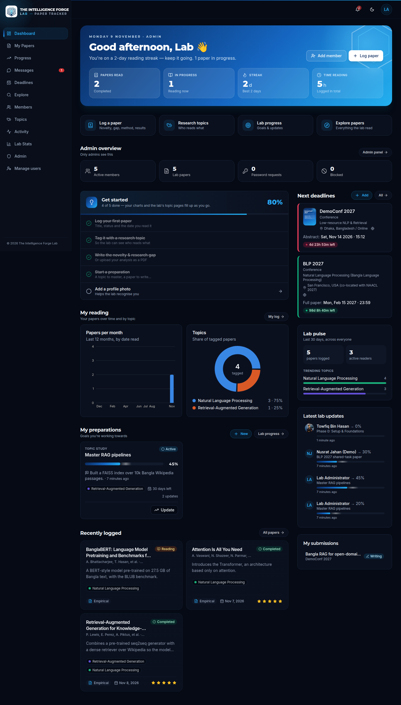
*The whole dashboard, from the banner down to Recently logged.*

The dashboard is your home page. From top to bottom:

**The blue banner**

- today's date and a greeting
- a one-line summary of your reading, for example your streak or how many papers you read in
  the last 30 days
- four numbers:

| Number | Meaning |
|---|---|
| **Papers read** | Papers with status **Completed** |
| **In progress** | Papers with status **Reading** |
| **Streak** | Days in a row on which you read a paper, counted by each paper's **Date read**. The best streak is shown underneath. |
| **Time reading** | Total hours you logged as "Time spent" |

- **Log paper** button. Admins also see **Add member**.

**Quick actions:** four shortcuts: **Log a paper**, **Research topics**, **Lab progress** and
**Explore papers**.

**Get started:** a checklist for new members. It disappears once every step is done.

1. Log your first paper
2. Tag it with a research topic
3. Write the novelty and research gap, or upload an analysis PDF
4. Start a preparation
5. Add a profile photo

Click any step to go straight to the right page.

**My reading:** two charts, papers per month and your topics. They appear after you log your
first paper.

**My preparations:** your active goals. Click **New** to add one.

**Recently logged:** your four newest papers.

**Right-hand column**

- **Next deadlines:** the three nearest conference or journal deadlines, with a countdown and
  the poster thumbnail. **+ Add** adds a new venue (see section 9).
- **Lab pulse:** papers logged by the whole lab in the last 30 days, how many people are
  reading, and the **trending topics**. Click a topic to open its page.
- **Latest lab updates:** recent progress updates from everyone
- **My submissions:** papers you plan to submit, with their status

---

## 6. Logging a paper

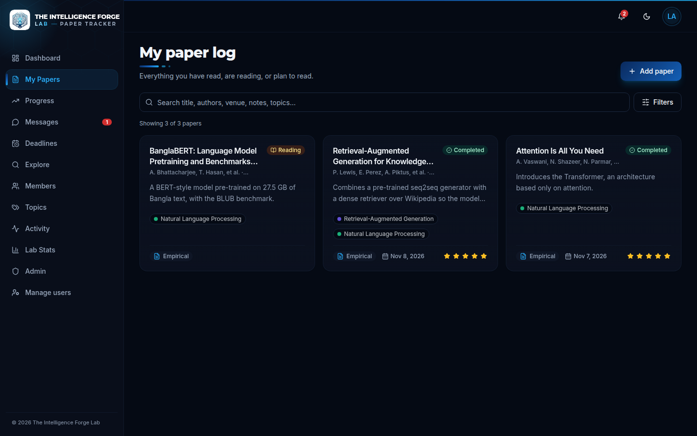
*My Papers: everything you have logged, with search and filters.*

Click **Log paper** on the dashboard, or **My Papers → Add paper**. The form has three parts.
Only the **Title** is required.

### Part 1: Bibliographic details

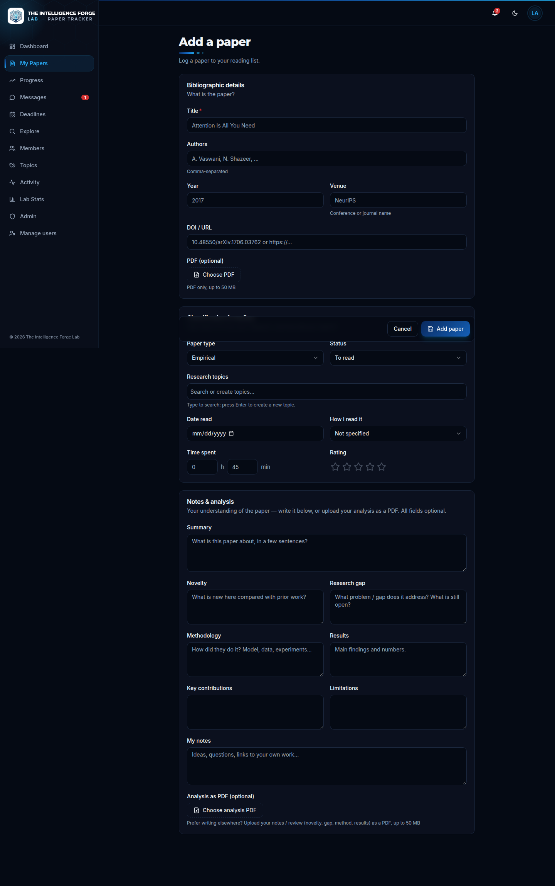
*The Add paper form (all three parts).*

- **Title**, **Authors** (comma-separated), **Year**, **Venue** (conference or journal),
  **DOI / URL**
- **PDF (optional):** the paper itself, up to **50 MB**

### Part 2: Classification and reading

- **Paper type:** Survey, Empirical, Theoretical, Review, Case study, Dataset or Other
- **Status:** **To read**, **Reading** or **Completed**
- **Research topics:** start typing to find a topic. If it doesn't exist yet, press **Enter**
  to create it. A paper can have several topics.
- **Date read**, **How I read it** (full read, skim, abstract only, group discussion), **Time
  spent** (hours and minutes), **Rating** (1–5 stars)

### Part 3: Notes and analysis

Write your understanding of the paper. Every field is optional.

| Field | What to write |
|---|---|
| **Summary** | What the paper is about, in a few sentences |
| **Novelty** | What is new compared with earlier work |
| **Research gap** | The problem or gap it addresses, and what is still open |
| **Methodology** | How they did it: model, data, experiments |
| **Results** | Main findings and numbers |
| **Key contributions** | The main contributions, in your words |
| **Limitations** | Weak points and assumptions |
| **My notes** | Your own ideas and questions |

**Prefer to write elsewhere?** Under **Analysis as PDF**, upload your notes or review as a PDF
(up to 50 MB) instead of typing. The lab can open it from the paper page and the topic page.

Click **Add paper** to save.

### Editing and deleting

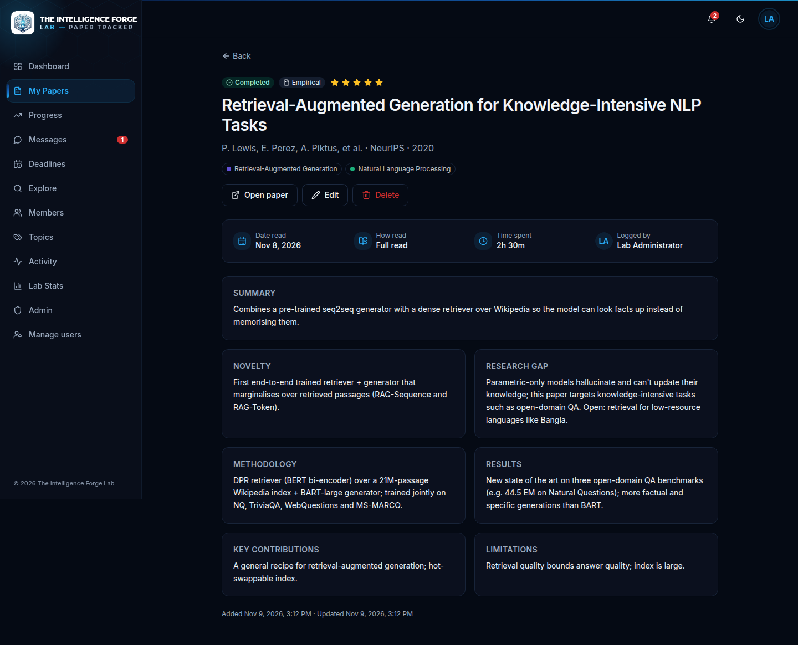
*A paper page with novelty, research gap, methodology and results.*

Open the paper from **My Papers**, then click **Edit** or **Delete**. Only you can edit your own
papers. Admins can delete any paper.

> **Tip:** set **Status = Completed** and fill in **Date read**. Otherwise the paper doesn't
> count towards your "Papers read", streak or charts.

---

## 7. Research topics: who reads what

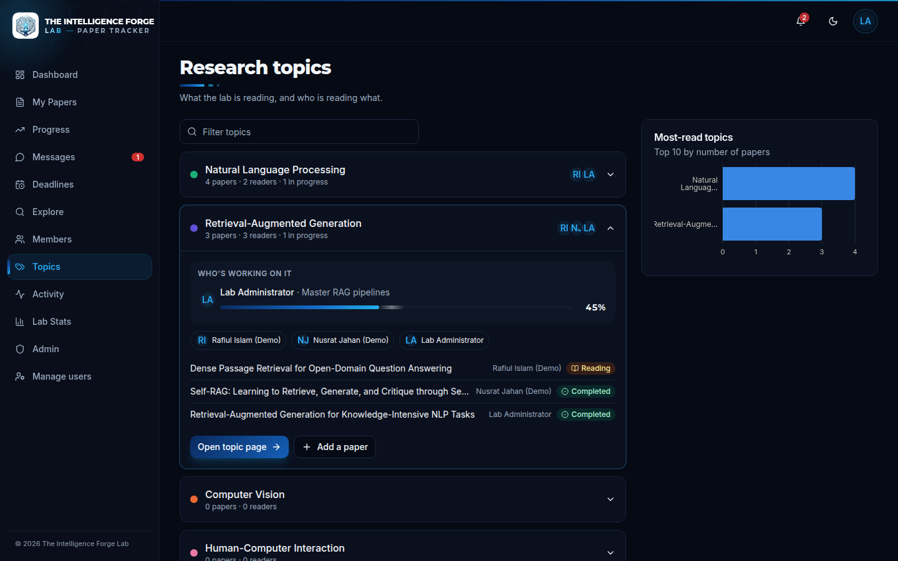
*Topics, with one topic opened.*

Click **Topics** in the sidebar. Every topic shows how many papers and readers it has.

- Click a topic to expand it. You see who is reading it, the latest papers, and anyone
  "working on it" in **Progress**.
- Click **Open topic page** for the full view.

### The topic page

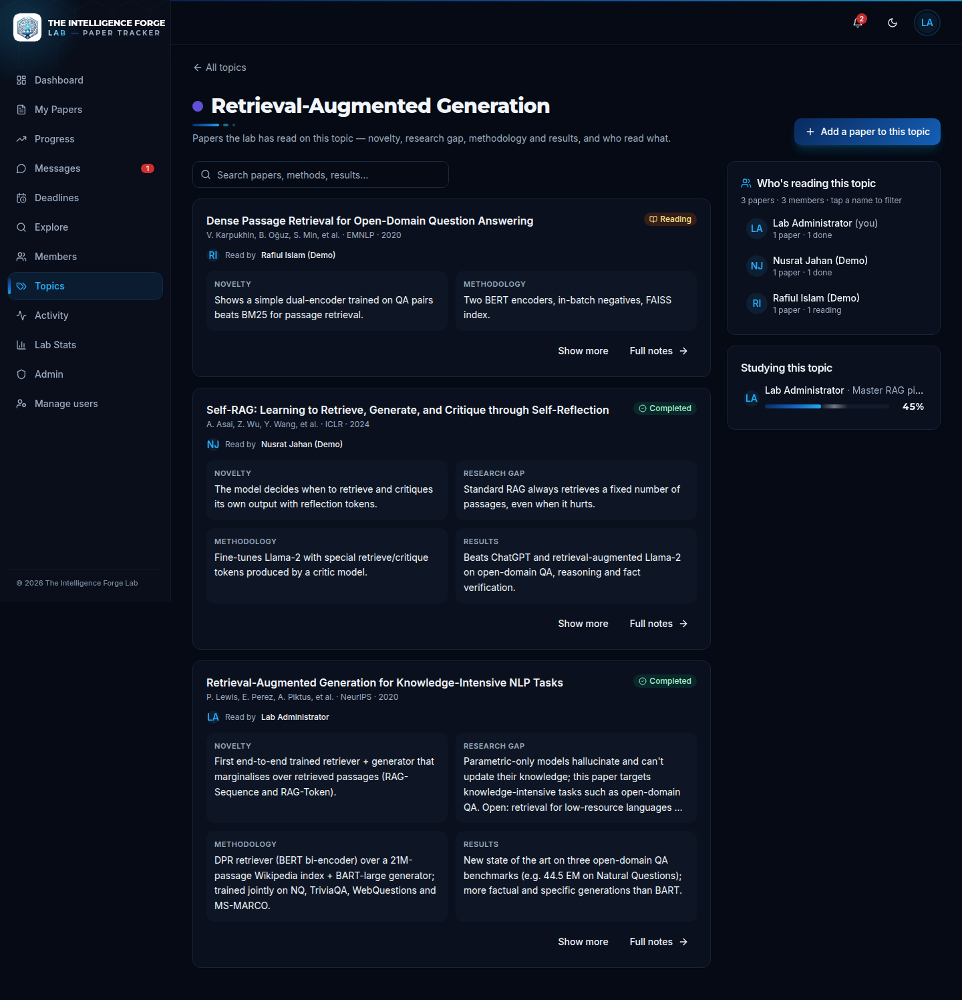
*A topic page: every paper with its analysis, and who is reading it.*

**Left: every paper on this topic.** Each card shows:

- the title, authors and venue, plus the status
- **who read it**
- their **Novelty**, **Research gap**, **Methodology** and **Results**. Click **Show more** to
  read the full text.
- an **Analysis PDF** button, if the reader uploaded one
- **Full notes**, which opens the complete paper page

Use the search box to look inside titles, methods and results.

**Right: "Who's reading this topic".** This lists every member with papers on the topic, with
counts for reading and done. **Click a name** to show only that person's papers. Click **Show
everyone** to undo.

**Add a paper to this topic** (top right) opens the paper form with this topic already
selected.

---

## 8. Progress: sharing your goals

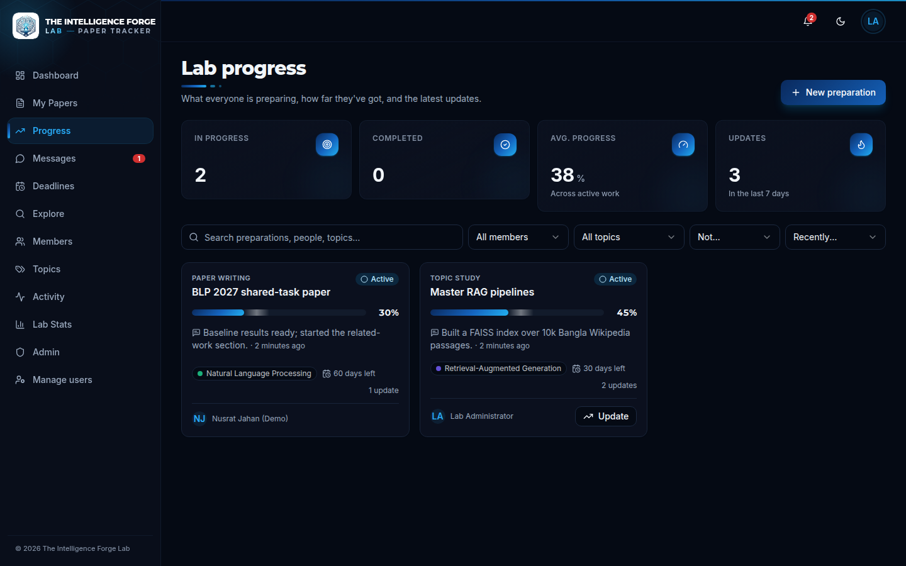
*The Progress board.*

A **preparation** is something you are working towards, for example learning a topic, writing
a paper, running an experiment or preparing for an exam. The whole lab can see it.

1. Open **Progress** and click **New preparation**, or use **New** on the dashboard.
2. Enter a **Title** and **Category**. Optionally add a **research topic**, a **target date**, a
   starting percentage and a description.
3. As you make progress, open the preparation and click **Post update**. Set the new
   percentage with the slider or the 10/25/50/75/100% buttons, and write what you did.
4. At **100%** it is marked **Completed** automatically.

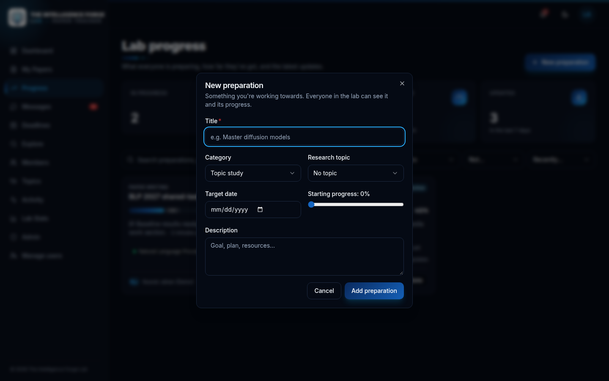
*New preparation.*

Your updates appear on the **Progress** board, on your profile, on the topic's page, in
**Activity**, and in **Latest lab updates** on everyone's dashboard.

---

## 9. Deadlines, submissions and posters

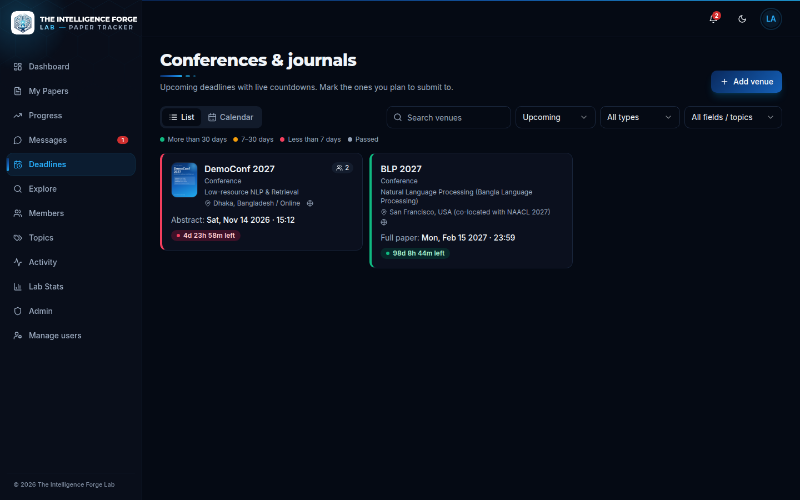
*Deadlines with live countdowns and posters.*

Open **Deadlines**. Venues are sorted by their nearest deadline, with a live countdown:

- 🟢 more than 30 days left
- 🟡 7–30 days left
- 🔴 less than 7 days left
- ⚪ passed

You can:

- switch between **List** and **Calendar**
- filter by upcoming or past, conference or journal, and field
- open a venue to see all its dates: abstract, full paper, notification and camera-ready

**Planning to submit?** Open the venue and click **I'm planning to submit**. Enter your paper
title and status (Planning, Writing, Submitted, Accepted or Rejected), and update it as you go.
It appears under **My submissions** on your dashboard.

### Adding a conference or journal (with a poster)

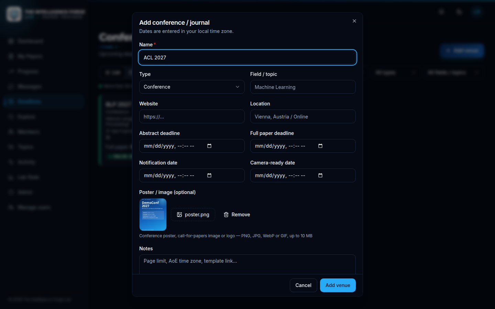
*Add conference / journal, with a poster chosen.*

1. Click **Add venue** on the Deadlines page, or **+ Add** under *Next deadlines* on the
   dashboard.
2. Enter the **Name** (for example "BLP 2027"), **Type**, **Field / topic**, **Website** and
   **Location**.
3. Fill in the dates you know: **Abstract deadline**, **Full paper deadline**, **Notification
   date** and **Camera-ready date**. Dates are in your own time zone.
4. **Poster / image (optional):** click **Choose image** and pick the conference poster,
   call-for-papers image or logo (PNG, JPG, WebP or GIF, up to **10 MB**). A preview appears.
5. Add **Notes** if useful (page limit, template link, AoE time…), then click **Add venue**.

The poster appears as a small picture on the deadline cards and large at the top of the venue

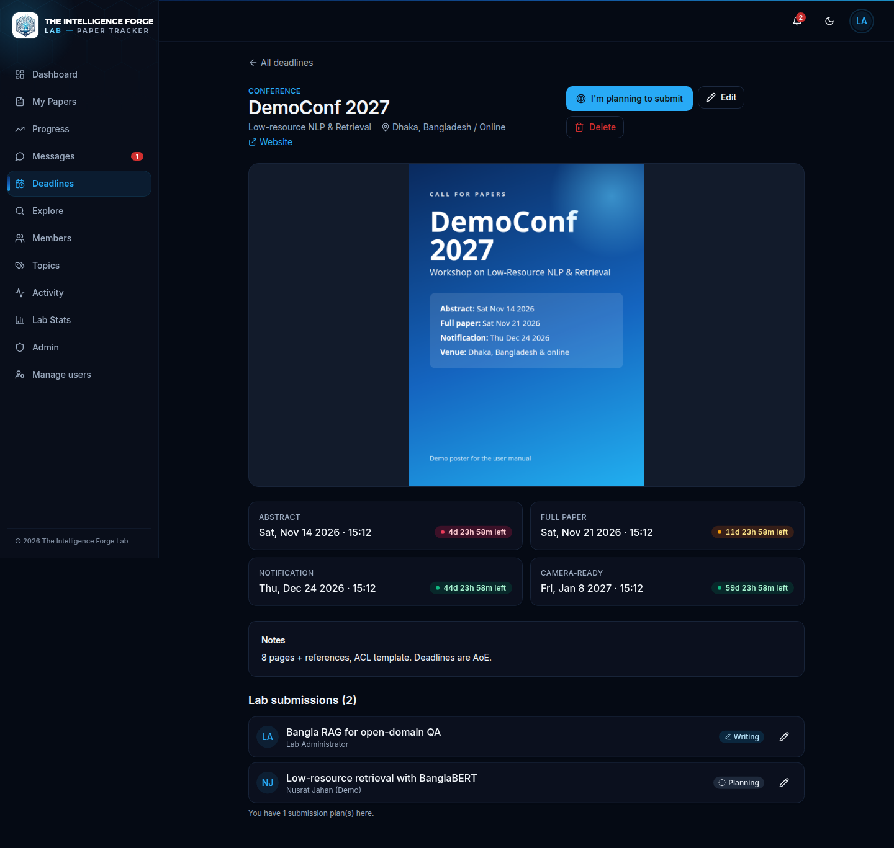
*A venue page: poster, all dates and who plans to submit.*

page. Click it there to open it full size. To change or remove it, open the venue and click
**Edit**.

Members can add venues when the admin has switched on **"Members can add conferences &
journals"** (it is on by default). You can edit or delete only the venues you added. Admins can
edit or delete any venue.

---

## 10. Messages: chat with the lab

**Messages** works like WhatsApp, inside the lab tracker. Open it from the sidebar.

### The screen

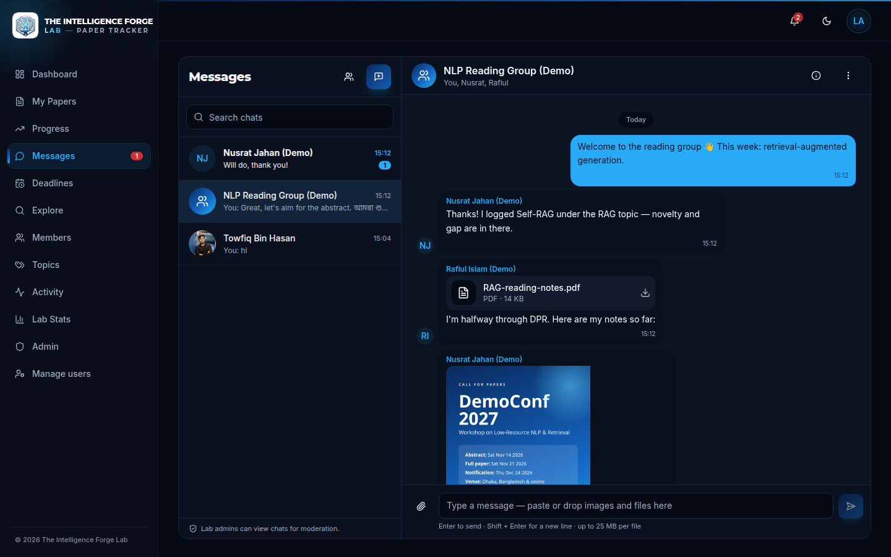
*Messages: chats on the left, the open group chat on the right (with a PDF and an image).*

- **Left:** your chats, newest first. Each row shows the last message and its time. Bold text
  and a blue number mean unread messages. A 🔒 means an admin has blocked that chat.
- **Right:** the open chat. Your messages are on the right in blue; other people's are on the
  left.

### Start a chat

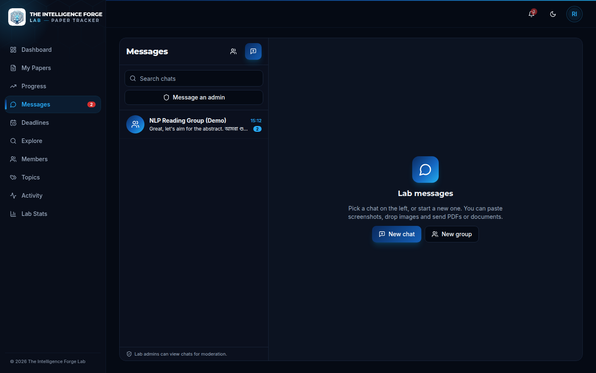
*A member's view, with New chat, New group and Message an admin.*

- **One-to-one:** click the blue **✚ (New chat)** button and pick a person. Admins are listed
  first. You can also open someone's profile from **Members** and click **Message**.
- **Message an admin:** click **Message an admin** under the search box.
- **Group:** click the **👥 (New group)** button, type a **Group name**, tick the members and
  click **Create group**. You become the group's **owner**.

### Send messages, images and files

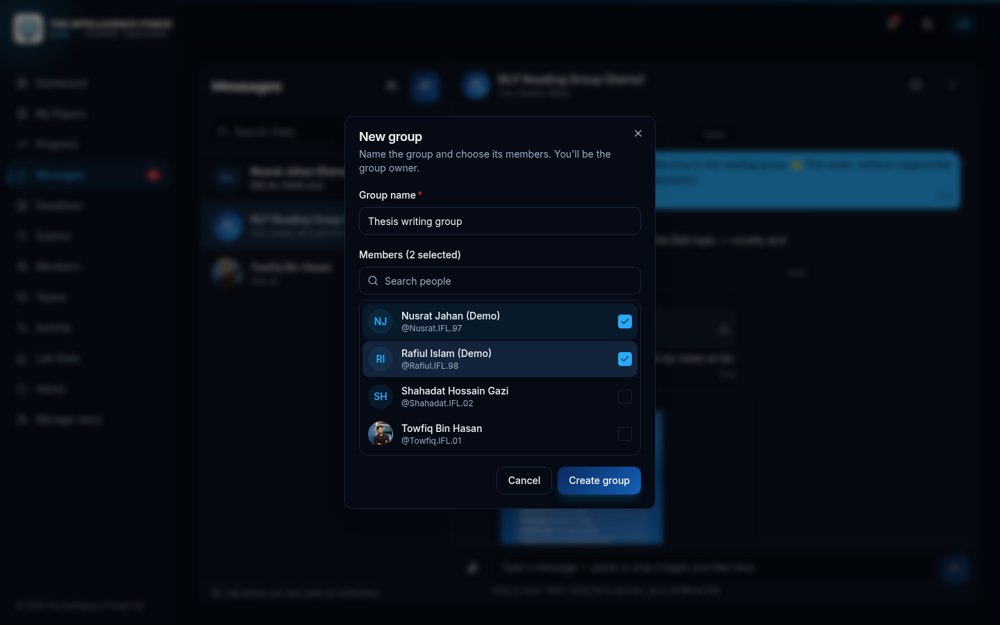
*New group: name it and tick the members.*

- Type in the box at the bottom and press **Enter** to send. **Shift + Enter** starts a new
  line. Bangla typing works normally.
- **Paste a screenshot or image:** copy it (for example with the Print Screen key or "Copy
  image"), click in the message box and press **Ctrl + V**.
- **Drag and drop:** drag files from your computer onto the chat.
- **📎 Attach:** pick files from your computer.

You can send **images** (PNG, JPG, WebP, GIF), **PDFs**, **Word, Excel and PowerPoint**
files, **text/CSV** and **ZIP**, up to **25 MB** each and up to 10 at a time. Files are listed
above the box before sending. Click **×** to remove one. Any text you type is sent with the
first file.

Images show inside the chat. Click one to open it full size. PDFs and documents show as a file
card. Click it to open or download.

### Message options

Hover over a message and click **⋮**:

- **Copy text**
- **Open / download** (for files)
- **Delete:** removes **your own** message for everyone. Admins can delete any message.

### Group info

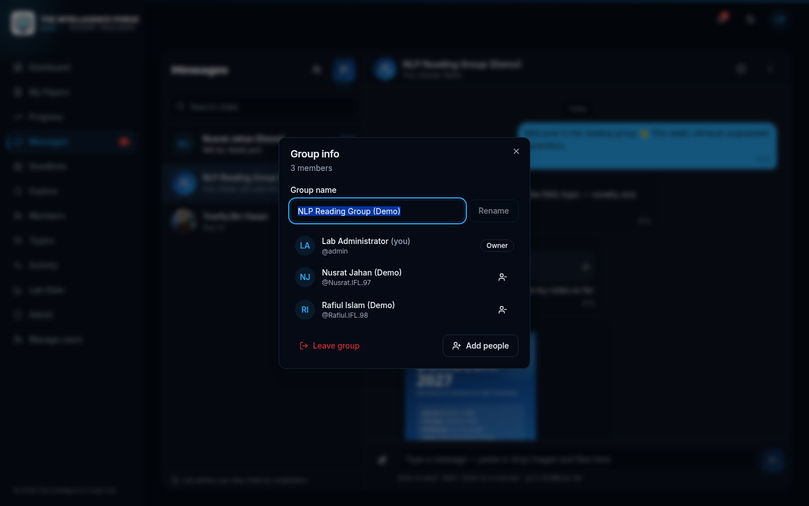
*Group info: members, rename, add or remove people, leave.*

In a group, click **ⓘ** at the top right to see the members. The **owner** (and admins) can
**rename** the group, **Add people** and remove members. Anyone can **Leave group**. If the
owner leaves, the longest-standing member becomes the new owner.

> **Privacy:** chats are visible only to their members **and to lab admins**, who can read
> chats for moderation. Don't share passwords or other secrets in chat.

---

## 11. Notifications and reminders

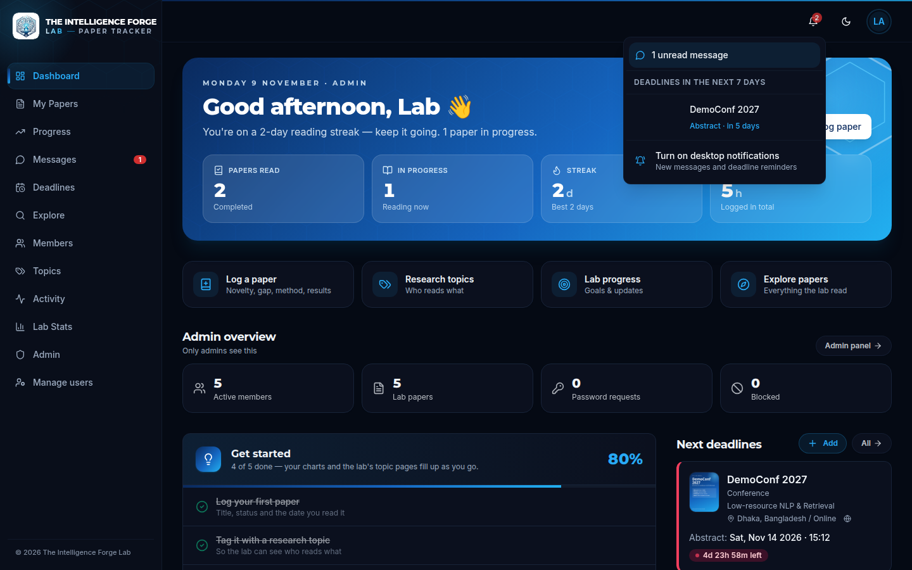
*The bell: unread messages, deadlines and Turn on desktop notifications.*

**In the app**

- The **🔔 bell** counts unread messages and deadlines in the next 7 days. Click it to see
  them, then click an item to open it.
- **Messages** in the sidebar shows your unread count.
- When a message arrives while you're on another page, a small pop-up appears at the bottom of
  the screen with an **Open** button.

**Deadline reminders.** The app reminds you about abstract and full-paper deadlines **7 days,
3 days, 1 day and on the day**. Each reminder is shown once, as a pop-up when you open the
app.

**Desktop notifications.** You can also get notifications even when the tab is in the
background:

1. Click the **🔔 bell** and choose **Turn on desktop notifications**.
2. When the browser asks, click **Allow**.

From then on, new messages and deadline reminders appear as notifications from your operating
system.

> Desktop notifications work while the Paper Tracker is open in a browser tab. It can be in
> the background or minimised, but not closed. If you clicked **Block** by mistake, click the
> 🔒 icon at the left of the address bar, set **Notifications** to **Allow**, and reload.

---

## 12. Exploring the lab

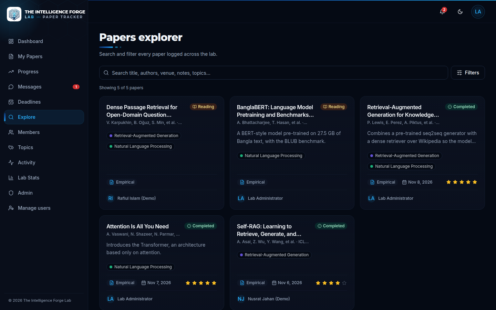
*Explore: every paper in the lab.*

| Page | How to use it |
|---|---|
| **Explore** | Search every paper in the lab. Filter by **topic, type, status, year or member**, and change the sort order. Click a paper to read its notes. |
| **Members** | Everyone in the lab. Click a person to see their profile, numbers, charts and papers. Their papers are read-only for you. |
| **Activity** | A timeline of new papers, submissions and progress updates |
| **Lab Stats** | Lab-wide charts: papers per month, topics, paper types and top readers |

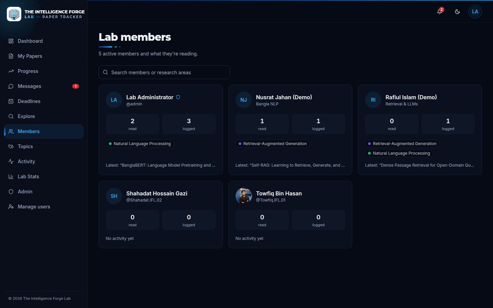
*Members.*

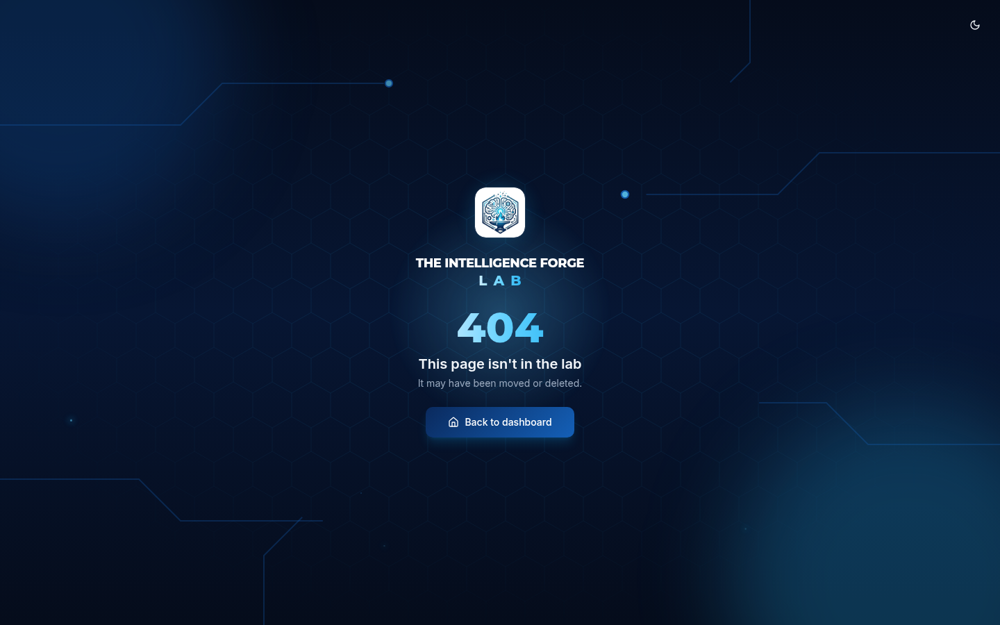
*A member's profile, with the Message button.*

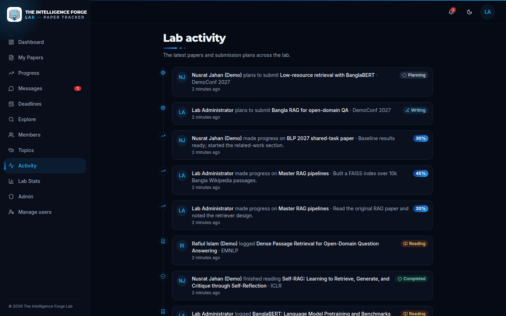
*Activity.*

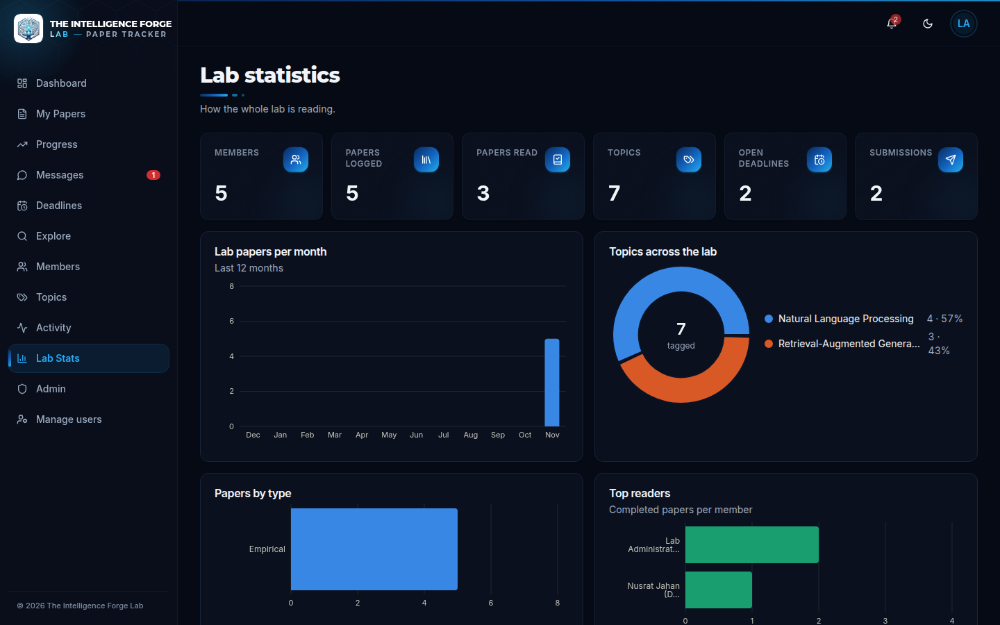
*Lab Stats.*

---

## 13. For admins

Only accounts with the **Admin** role can do the things in this section. Members don't see the
**Admin** or **Manage users** links, can't open those pages, and the server rejects their
requests.

### 13.1 The admin overview on the dashboard

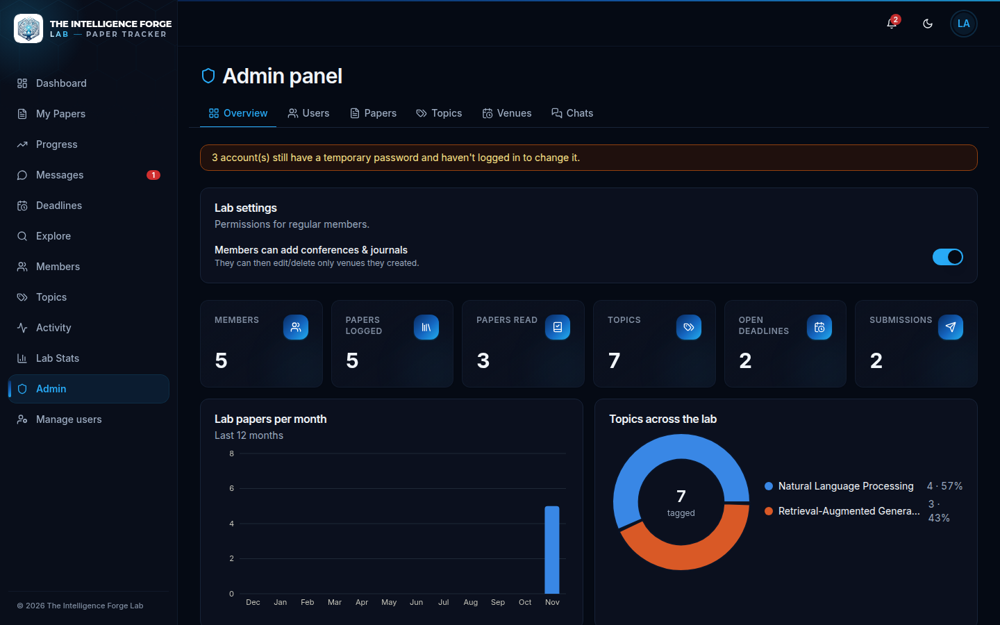
*Admin → Overview.*

Admins see an extra row on the dashboard. Click any tile to jump to the admin pages.

| Tile | Meaning |
|---|---|
| **Active members** | Accounts that can sign in |
| **Lab papers** | Every paper logged in the lab |
| **Password requests** | Turns yellow when someone is waiting for a reset |
| **Blocked** | Blocked accounts |

### 13.2 Manage users

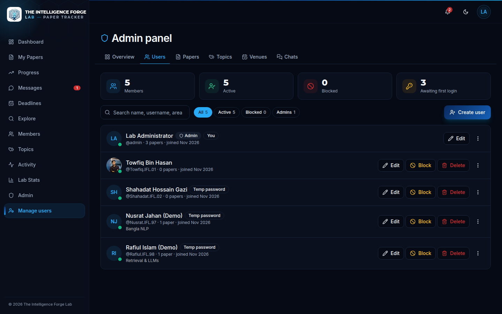
*Manage users: summary, filters, and Edit / Block / Delete on every row.*

Open **Manage users** in the sidebar, or **Admin → Users**.

**At the top:** counts of **Members**, **Active**, **Blocked** and **Awaiting first login**
(people who haven't replaced their temporary password yet).

**Search and filters:** search by name, username or research area. Use the **All / Active /
Blocked / Admins** buttons to filter.

**Each user's row** has a dot on the photo: 🟢 means active, 🔴 means blocked. It also has
these buttons:

| Button | What it does |
|---|---|
| ✏️ **Edit** | Change **full name**, **username**, **research area** and **bio** |
| 🚫 **Block** | Asks for confirmation, then signs the person out and stops them signing in. Their papers stay. The row shows **Blocked**. |
| ✅ **Unblock** | Shown instead of Block for blocked users. Restores sign-in. |
| 🗑️ **Delete** | **Permanently** deletes the account, all their papers, PDFs and submissions. **This cannot be undone.** |
| ⋮ **More** | **Reset password**, **Make admin** / **Make member** |

**Safety rules:**

- You can't block or delete your own account.
- You can't block, delete or demote the **last** admin.
- If you might ever need the person's data again, **Block** instead of Delete.

> **Changing a username:** the person signs in with the **new** username from then on, and
> their password stays the same. Tell them about the change.

### 13.3 Create a user

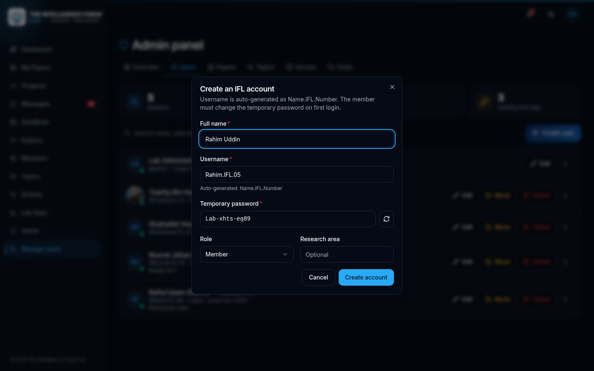
*Create user.*

1. **Manage users → Create user**.
2. Type the **full name**. A username like `Rahim.IFL.04` is suggested, and you can change it.
3. Keep the generated **temporary password** or type one. It needs 8+ characters with letters
   and numbers.
4. Choose **Member** or **Admin**, and optionally a research area.
5. Click **Create account**. The username and password are shown **once**. Click **Copy** and
   send them to the person privately.

### 13.4 Password requests

When someone uses **Forgot password?**, the request shows under the **🔔 bell** and at the top
of **Manage users**.

- Click **Reset password**. A new temporary password is shown once. Send it to the person
  privately, and the request closes automatically.
- Click **Dismiss** to close a request without acting on it.

You can also reset anyone's password at any time from **⋮ → Reset password**.

### 13.5 Other admin pages

Open **Admin** in the sidebar. The tabs along the top are:

| Tab | Use |
|---|---|
| **Overview** | Lab statistics, and the switch **"Members can add conferences & journals"** |
| **Users** | Same as **Manage users** |
| **Papers** | Search every paper and delete duplicates or mistakes |
| **Topics** | Create, rename, recolour or delete topics. Deleting a topic only removes the tag; papers stay. |
| **Venues** | Add, edit or delete conferences and journals |
| **Chats** | Every chat in the lab: read, block and delete (see 13.6) |

### 13.6 Moderating chats

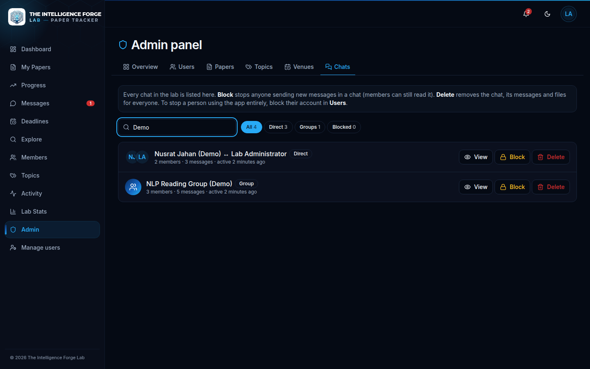
*Admin → Chats: View, Block and Delete for every chat.*

Open **Admin → Chats**. Every direct chat and group in the lab is listed, with its members,
the number of messages and the last activity. Use the search box and the **All / Direct /
Groups / Blocked** filters to find one.

| Button | What it does |
|---|---|
| 👁 **View** | Opens the chat so you can read it. Hover a message and use **⋮ → Delete** to remove it. |
| 🔒 **Block** | Nobody can send new messages in that chat. Members can still read it and see that it is blocked. |
| 🔓 **Unblock** | Allows messages again |
| 🗑️ **Delete** | **Permanently** deletes the chat with all its messages and files, for everyone |

You can do the same from inside any chat you are in, with the **⋮** menu at the top right.

> **Blocking a chat vs. blocking a person:** blocking a chat only stops messages in that chat.
> To stop someone using the app entirely, block their account in **Manage users** (13.2). A
> blocked account can't send messages anywhere.

---

## 14. Common questions

**My charts say "No data yet".**
You haven't logged a paper yet. Log one, set **Status = Completed** and fill in **Date read**.

**My streak is 0.**
The streak counts days in a row that have a paper with that **Date read**. It must include today
or yesterday, and a day with no paper resets it.

**I can't edit someone else's paper.**
That's expected. Only the person who logged a paper can edit it.

**A topic I need doesn't exist.**
In the paper form, type the topic name in **Research topics** and press **Enter**.

**My PDF won't upload.**
Only PDF files up to **50 MB** are accepted.

**I was signed out and can't sign in.**
Your account may be blocked, or your password was reset. Contact your lab admin.

**Messages doesn't appear in my sidebar.**
Chat hasn't been set up yet. Ask your admin to run the latest database update.

**I can't send messages in a chat.**
An admin has blocked that chat (you'll see 🔒 **Blocked**), or you are no longer in the group.

**My file won't send.**
Files must be under 25 MB and be an image, PDF, Office document, text/CSV or ZIP.

**I don't get desktop notifications.**
Turn them on from the 🔔 bell, and keep the Paper Tracker open in a tab. Check that the browser
and your computer's "Do not disturb" mode allow notifications.

**Who can see my papers and notes?**
Everyone in the lab who is signed in. Nothing is public on the internet.

---

*Can't find an answer? Ask your lab admin.*
